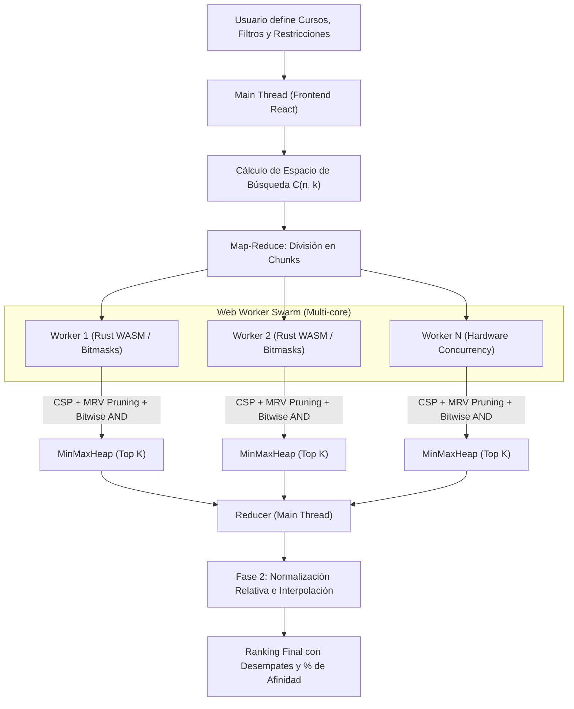
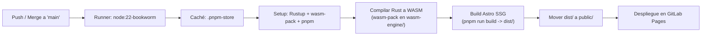

# 🎓 MatrícuLAB 2.0 — Asistente Inteligente y Optimizador de Horarios UTEC

<div align="center">


**La plataforma definitiva para planificar, optimizar algorítmicamente y exportar tus horarios en la Universidad de Ingeniería y Tecnología (UTEC).**

[Características](#-características-principales) • [Arquitectura Algorítmica](#-arquitectura-y-motor-de-optimización) • [Buscador de Aulas](#-buscador-de-aulas-libres-aulas) • [Instalación](#-instalación-y-desarrollo-local) • [CI/CD](#-pipeline-de-cicd-gitlab-pages) • [Privacidad](#-privacidad-y-seguridad)

</div>

---

## 📌 ¿Qué es MatrícuLAB?

**MatrícuLAB** es una aplicación web de alto rendimiento creada por y para estudiantes de **UTEC**. Su objetivo es eliminar el estrés de la matrícula universitaria resolviendo de manera automatizada el problema combinatorio de armar un horario libre de cruces, adaptado a tus preferencias personales y optimizado al milisegundo.

Permite cargar tus documentos oficiales de UTEC (Excel de horarios o PDFs de carga hábil / consolidado), armar horarios manualmente en una grilla interactiva, o dejar que el **motor de optimización matemática multihilo (Web Workers + Rust WASM)** explore millones de combinaciones para entregarte las mejores opciones clasificadas por afinidad.

---

## ✨ Características Principales

### 1. 📅 Armador Manual e Interactivo de Horarios
* **Grilla Semanal Intuitiva:** Visualización clara de lunes a sábado de 07:00 a 22:00 con bloques diferenciados por colores armónicos por curso.
* **Detalle Completo de Sesión:** Información visual directa de tipo de clase (*Teoría*, *Práctica*, *Laboratorio*), aula asignada, docente y vacantes disponibles.
* **Detección de Cruces en Tiempo Real:** Detección instantánea de choques de horario con alertas contextuales y resaltado de conflictos.
* **Previsualización Dinámica (Hover & Drag):** Pasa el cursor sobre cualquier sección para previsualizar cómo encaja en tu semana antes de seleccionarla.
* **Pestañas Multi-Horario:** Crea, duplica y compara múltiples alternativas (*Opción A*, *Opción B*, *Opción C*, etc.) en paralelo.
* **Bloqueador de Horarios (Time Blocker Grid):** Marca franjas horarias no disponibles (trabajo, entrenamiento, transporte o descanso) para que el optimizador nunca asigne clases en esos momentos.
* **Microinteracciones y Confeti:** Efecto festivo al completar un horario de 3 o más cursos sin ningún cruce.

---

### 2. ⚡ Optimizador Automático 2.0 (Generación de Horarios)
Olvídate de cuadrar secciones a mano. El optimizador evalúa todas las permutaciones posibles y te entrega un ranking con los mejores horarios.

* **Modo Básico:** Elige los cursos exactos que deseas cursar y el algoritmo encuentra todas las combinaciones de secciones válidas.
* **Modo Avanzado (Bolsa Combinatoria $C(n,k)$):** Selecciona una bolsa amplia de cursos candidatos (ej. 10 cursos entre obligatorios y electivos) e indica cuántos deseas llevar (ej. *"Armar horarios con 5 cursos de esta lista"*). El sistema evalúa todas las combinaciones de cursos y secciones posibles.
* **Secciones Fijadas (Pinning):** ¿Quieres llevar un profesor específico o una sección inamovible? Fíjala con un clic y el algoritmo optimizará el resto de cursos alrededor de ella.
* **Filtros y Penalizaciones Personalizadas:**
  * **⚡ Menos huecos:** Minimiza las horas muertas entre clases.
  * **📅 Menos días:** Compacta la semana en la menor cantidad de días de asistencia posibles.
  * **🚫 Sin días puente:** Penalización estricta (`-1000 pts`) a los horarios que dejan días libres aislados entre días con clases (ej. clases lunes y miércoles con martes libre).
  * **🌅 Preferencia Mañana:** Bonificación a clases que inician antes del mediodía (12:00 PM).
  * **🌇 Preferencia Tarde:** Bonificación a clases que inician a partir del mediodía.
  * **🥪 Garantía de Almuerzo:** Define una ventana horaria (ej. 12:00 a 15:00) y duración mínima para asegurar tu almuerzo sin clases.

---

### 3. 📄 Soporte Integral de Archivos Oficiales UTEC
* **Excel de Catálogo (`Consulta_Horario.xlsx`):** Carga masiva de la oferta académica completa del ciclo con vacantes, profesores, aulas y tipos de sesión.
* **PDF de Cursos Habilitados (Carga Hábil):** Extracción automatizada con `pdfjs-dist` de tus datos de alumno (*Nombre*, *Código*, *Carrera*, *Malla*) clasificando automáticamente los cursos en **Obligatorios**, **Electivos** y **Habilitados**.
* **PDF de Consolidado de Matrícula / Horario:** Visualiza instantáneamente tu horario oficial una vez matriculado.
* **Normalización Inteligente:**
  * Limpieza automática de prefijos de aulas (ej. transforma `UTEC-BA A804` en un legible `A804`).
  * Agrupación robusta de sub-secciones complejas (Teoría + Laboratorio) guiada por recuento de vacantes para evitar desajustes en cursos multigrupo (*Álgebra Lineal*, *Química General*).

---

### 4. 📤 Exportación e Integraciones
* **📅 Google Calendar:** Sincronización nativa directa mediante **Google OAuth 2.0**. Crea eventos recurrentes durante todo el semestre académico con ubicación, aula, nombre del docente y paleta de colores oficial de Google Calendar.
* **📆 Archivo iCalendar (`.ics`):** Exporta un archivo estándar compatible con Apple Calendar, Microsoft Outlook y Google Calendar móvil.
* **🖼️ Imagen PNG en Alta Resolución:** Descarga tu horario semanal renderizado limpiamente para compartir o usar como fondo de pantalla.
* **✉️ Respaldo por Correo:** Envío directo del resumen del consolidado vía EmailJS.

---

### 5. 🏫 Buscador de Aulas Libres (`/aulas`)
¿Buscas un lugar tranquilo para estudiar o hacer trabajos grupales en el campus?
* Encuentra aulas, laboratorios y mesas de estudio desocupadas en tiempo real en UTEC.
* Filtra por **piso**, **edificio**, **tipo de espacio** o consulta la disponibilidad en cualquier rango horario futuro.
* Línea de tiempo interactiva que muestra las horas exactas en las que cada salón se encuentra libre u ocupado.

---

## 🧠 Arquitectura y Motor de Optimización

El núcleo de optimización de MatricuLAB 2.0 fue diseñado para superar las limitaciones de cómputo de JavaScript en el navegador mediante técnicas matemáticas y arquitecturas distribuidas:



### 1. CSP (Constraint Satisfaction Problem) y Heurística MRV
En lugar de iterar por fuerza bruta ($O(n^2)$), los cursos se ordenan según la heurística **Minimum Remaining Values (MRV)**: se colocan primero los cursos con menor cantidad de secciones disponibles (más restrictivos). Si una sección genera conflicto, el algoritmo **poda toda la rama de búsqueda**, evitando calcular millones de combinaciones inviables.

### 2. Detección de Colisiones por Mapas de Bits (Bitmasks en $O(1)$)
Los horarios de la semana se traducen a enteros de 64 bits (`BigInt`). Cada bloque de 15/30 minutos es un bit en la máscara. La detección de cruces entre dos clases o con el bloqueador de tiempo se resuelve en un solo ciclo de CPU evaluando la conjunción a nivel de bits ($\land$):

$$\text{colision} = (\mathbf{mask}_A \land \mathbf{mask}_B) \neq 0$$

Equivalente a nivel de implementación en TypeScript:
```typescript
const hayColision = (maskA & maskB) !== 0n;
```

### 3. Enjambre Paralelo (Web Worker Swarm + Rust WASM)
* **Web Workers:** Se distribuye la carga entre tantos hilos paralelos como núcleos físicos posea el dispositivo (`navigator.hardwareConcurrency`).
* **QuantumEngine (Rust compilado a WebAssembly):** Módulo nativo ultraoptimizado (`wasm-engine/`) que ejecuta la búsqueda exhaustiva y cálculo de métricas en memoria lineal sin pausas de Garbage Collector.

### 4. Sistema de Puntuación en Dos Fases
1. **Fase 1 (Heurística Masiva en Workers):** Calcula un `rawScore` rápido para descartar opciones y alimentar una cola de prioridad (`MinMaxHeap`) que retiene los mejores horarios.
2. **Fase 2 (Normalización Relativa en Frontend):** Evalúa el Top seleccionado contra el resto mediante interpolación lineal relativa, ponderando cada filtro para generar una puntuación porcentual humana (0% a 100%) con desempates por minutos de hueco, días activos y fin de jornada.

---

## 📁 Estructura del Proyecto

```text
Matricula/
├── .gitlab-ci.yml              # Pipeline CI/CD para compilación y despliegue en GitLab Pages
├── astro.config.mjs            # Configuración de Astro, integración React y optimización Rollup
├── package.json                # Dependencias del proyecto (Astro, React, Lucide, PDF.js, etc.)
├── wasm-engine/                # Motor de optimización en Rust compilado a WebAssembly
│   ├── Cargo.toml              # Manifiesto de Rust (wasm-bindgen, serde, gloo-timers)
│   └── src/lib.rs              # QuantumEngine: evaluación CSP y bitmasks nativos
├── docs_v2/                    # Documentación técnica y de usuario detallada
│   ├── Asignacion_Puntos.md    # Especificación matemática del sistema de scoring
│   ├── README_TECH.md          # Changelog técnico de la versión 2.0
│   └── README_USER.md          # Guía detallada para el estudiante
├── public/                     # Recursos estáticos (logos, favicons)
└── src/
    ├── components/             # Componentes React de la interfaz
    │   ├── ClassroomFinder/    # Módulo de Buscador de Aulas Libres (/aulas)
    │   │   ├── ClassroomApp.tsx
    │   │   ├── ClassroomCard.tsx
    │   │   ├── ClassroomFilterBar.tsx
    │   │   └── ClassroomTimeline.tsx
    │   ├── CourseSidebar.tsx   # Panel lateral de cursos, filtros y selección de secciones
    │   ├── TimetableGrid.tsx   # Grilla semanal interactiva con drag-and-drop
    │   ├── ScheduleOptimizerModal.tsx # Modal del optimizador con enjambre de Web Workers
    │   ├── GoogleCalendarModal.tsx    # Integración con Google Calendar OAuth 2.0
    │   ├── TimeBlockerGrid.tsx # Grilla para bloquear franjas horarias personales
    │   ├── MultiScheduleTabs.tsx      # Gestión de pestañas (Opción A, B, C...)
    │   ├── FileUploadModal.tsx # Carga y procesamiento de Excel y PDFs
    │   └── ExportModal.tsx     # Opciones de exportación (.ics, PNG, correo)
    ├── pages/                  # Rutas de Astro
    │   ├── index.astro         # Página principal (Armador y Optimizador)
    │   ├── aulas.astro         # Página del Buscador de Aulas Libres
    │   ├── privacy.astro       # Política de privacidad
    │   └── terms.astro         # Términos y condiciones
    ├── styles/                 # Hojas de estilo CSS (Glassmorphism, Dark UI, Responsive)
    ├── types/                  # Definiciones de tipos TypeScript (Course, Session, Metrics...)
    └── utils/                  # Lógica de negocio y utilitarios
        ├── excelParser.ts      # Parser para Consulta_Horario.xlsx de UTEC
        ├── pdfParser.ts        # Parser para Carga Hábil y Consolidados PDF
        ├── scheduleOptimizer.ts# Lógica CSP y cálculo de métricas
        ├── scheduleWorker.ts   # Web Worker para cómputo multihilo
        ├── googleCalendarService.ts # API Client de Google Calendar
        ├── icsExporter.ts      # Generador de archivos .ics estándar
        ├── classroomUtils.ts   # Cálculo de disponibilidad de aulas
        └── emailService.ts     # Integración de correo vía EmailJS
```

---

## 🛠️ Tecnologías Utilizadas

| Categoría | Tecnología | Uso |
| :--- | :--- | :--- |
| **Framework Web** | [Astro](https://astro.build/) (v7.x) | Arquitectura moderna con carga ultra rápida |
| **Interfaz de Usuario** | [React](https://react.dev/) (v19) + [TypeScript](https://www.typescriptlang.org/) | Componentes interactivos, reactividad y tipado estricto |
| **Motor de Cómputo** | [Rust](https://www.rust-lang.org/) + [WebAssembly](https://webassembly.org/) | Algoritmo QuantumEngine para resolución CSP a nivel nativo |
| **Paralelismo** | Web Workers API | Arquitectura Map-Reduce distribuida en la CPU del cliente |
| **Procesamiento de Datos** | [PDF.js](https://mozilla.github.io/pdf.js/) & [SheetJS (XLSX)](https://sheetjs.com/) | Lectura y extracción de datos desde PDFs y Excels de UTEC |
| **Integraciones** | Google Calendar API (OAuth 2.0) & EmailJS | Sincronización de eventos y envío de horarios por correo |
| **Diseño y Estilos** | CSS Moderno (Vanilla) & Lucide Icons | Estética glassmorphic oscura, responsiva y de alta fidelidad |

---

## 🚀 Instalación y Desarrollo Local

### Requisitos Previos
* **Node.js**: `>= 22.12.0`
* **pnpm**: `>= 9.0.0`
* **Rust & wasm-pack** *(opcional, solo si deseas modificar o recompilar el motor WASM)*:
  ```bash
  curl --proto '=https' --tlsv1.2 -sSf https://sh.rustup.rs | sh
  curl https://rustwasm.github.io/wasm-pack/installer/init.sh -sSf | sh
  ```

### Pasos de Instalación

1. **Clonar el repositorio:**
   ```bash
   git clone https://gitlab.com/farsep/utec-scheduler.git
   cd utec-scheduler
   ```

2. **Compilar el motor Rust WASM (si es necesario):**
   ```bash
   cd wasm-engine
   wasm-pack build --target web
   cd ..
   ```

3. **Instalar dependencias de Node:**
   ```bash
   pnpm install
   ```

4. **Iniciar el servidor de desarrollo:**
   ```bash
   pnpm dev
   ```
   > Abre tu navegador en `http://localhost:4321` para ver la aplicación en vivo.

5. **Construir para producción:**
   ```bash
   pnpm build
   ```

---

## 🔄 Pipeline de CI/CD (GitLab Pages)

El proyecto cuenta con un flujo de integración y despliegue continuo completamente automatizado definido en [`.gitlab-ci.yml`](.gitlab-ci.yml), configurado para desplegar la aplicación en **GitLab Pages** cada vez que se realizan cambios en la rama principal (`main`).



### Detalles del Pipeline:

* **Entorno de Ejecución:** Imagen Docker oficial `node:22-bookworm` (Debian Bookworm con Node.js 22 LTS).
* **Caché Persistente:** 
  - Indexado mediante la clave del archivo `pnpm-lock.yaml`.
  - Preserva el directorio `.pnpm-store` entre ejecuciones sucesivas para acelerar drásticamente la instalación de paquetes.
* **Fase de Preparación (`before_script`):**
  1. **Instalación de Rust:** Descarga el compilador oficial mediante `rustup` y carga las variables de entorno de Cargo.
  2. **Instalación de `wasm-pack`:** Herramienta CLI para compilar Rust hacia binarios WebAssembly (`.wasm`) optimizados para navegadores web.
  3. **Activación de `pnpm 9`:** Utiliza `corepack` nativo de Node.js (`corepack enable && corepack prepare pnpm@9 --activate`) y fija el almacén en `.pnpm-store`.
* **Fase de Compilación y Ensamblado (`script`):**
  1. **Compilación de WASM:** Accede al directorio `wasm-engine/` y ejecuta `wasm-pack build --target web`, generando el módulo compilado y sus bindings TypeScript en `wasm-engine/pkg/`.
  2. **Instalación de Dependencias Web:** Ejecuta `pnpm install` para resolver todos los paquetes de Node y enlazar el motor WASM.
  3. **Generación del Sitio Estático:** Ejecuta `pnpm run build`, procesando los componentes React, estilos y rutas de Astro para emitir el bundle de producción en `dist/`.
  4. **Adaptación para GitLab Pages:** Como GitLab Pages publica exclusivamente los archivos situados en el directorio `public/`, el pipeline reemplaza la carpeta `public` estática con los artefactos compilados (`rm -rf public && mv dist public`).
* **Artefactos Publicados (`artifacts`):**
  - Publica la carpeta `public/` completa para su distribución a través del CDN de GitLab Pages.
* **Condiciones de Ejecución (`rules`):**
  - El despliegue (`pages`) se ejecuta de manera automática **únicamente ante commits o merges en la rama `main`**, protegiendo el entorno público de cambios en ramas de desarrollo o experimentales.

---

## 🔒 Privacidad y Seguridad

* **100% Client-Side:** Todo el análisis de tus documentos (PDF de notas, carga hábil, consolidado) y el cálculo combinatorio se ejecuta **exclusivamente en tu navegador**.
* **Cero Almacenamiento Externo:** Ninguna información personal, nombres, códigos ni horarios son enviados a servidores de terceros ni almacenados en bases de datos externas.
* **Google OAuth Seguro:** La sincronización con Google Calendar utiliza tokens de acceso temporales que nunca salen de tu sesión local de navegador.

---

## 🤝 Contribuciones y Soporte

Las sugerencias, reportes de bugs y contribuciones son siempre bienvenidos. Si encuentras un caso especial en el parser de PDFs o quieres proponer un nuevo criterio de optimización:

1. Haz un Fork del proyecto.
2. Crea una rama para tu funcionalidad (`git checkout -b feature/nueva-mejora`).
3. Realiza tus cambios y haz commit (`git commit -m 'Añade nueva funcionalidad'`).
4. Sube tu rama (`git push origin feature/nueva-mejora`).
5. Abre un Merge Request / Pull Request.

---

<div align="center">

Hecho con ❤️ para la comunidad de **UTEC**.

</div>
