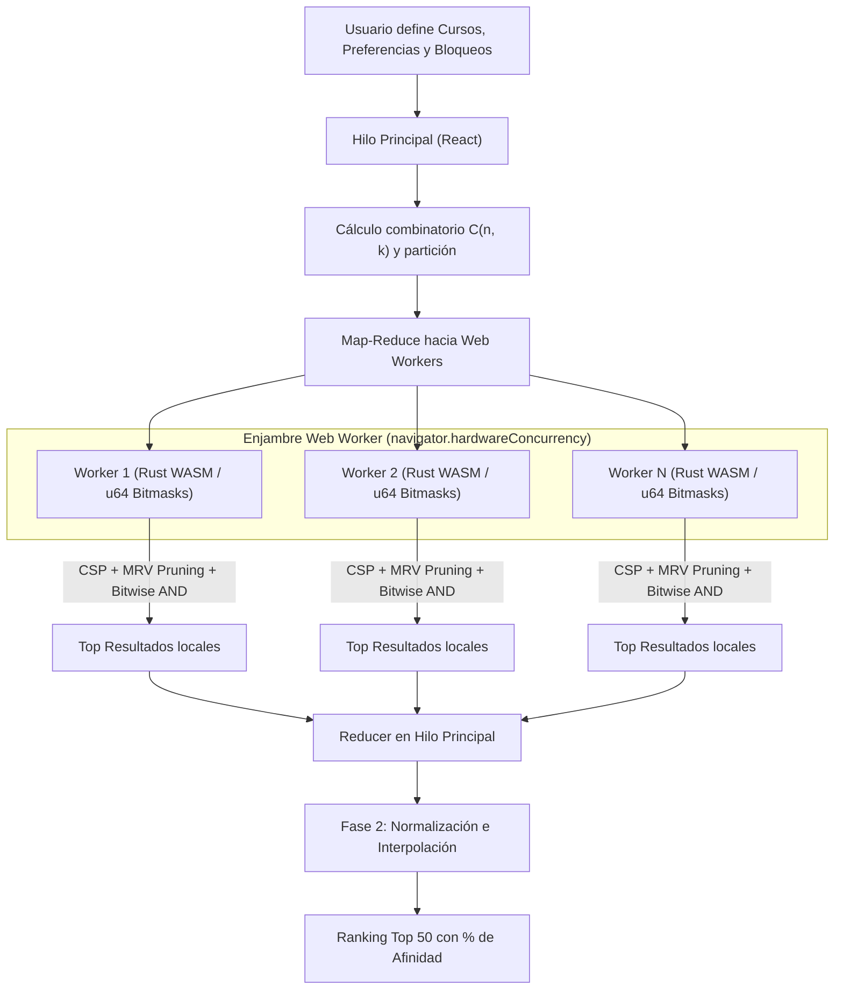
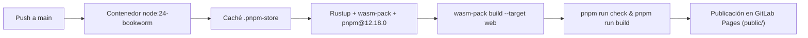

# 🏛️ MatrícuLAB 2.0 — Ecosistema Académico UTEC

<div align="center">


**Plataforma integral de planificación universitaria para la Universidad de Ingeniería y Tecnología (UTEC): armador de horarios con motor combinatorio en Rust WebAssembly, malla curricular interactiva de 16 carreras, catálogo de cursos y oyentes, radar de aulas consciente de fechas reales, directorio docente, red de mentores, paleta global `⌘K` y motor de gestos nativo multidispositivo.**

[Estética Grafton Swiss](#-sistema-visual-polychrome-grafton-swiss-concrete) • [Módulos del Ecosistema](#-módulos-del-ecosistema) • [Motor de Gestos y ⌘K](#-motor-de-gestos-nativo-y-paleta-k) • [Motor QuantumEngine](#-arquitectura-y-motor-de-optimización) • [Arquitectura SPA](#-arquitectura-de-navegación-instantánea-y-datos) • [Estructura](#-estructura-del-proyecto) • [Instalación](#-instalación-y-desarrollo-local)

</div>

---

## 📌 ¿Qué es MatrícuLAB 2.0?

**MatrícuLAB 2.0** reúne **seis módulos académicos interconectados** dentro de una sola aplicación híbrida de transición instantánea (`0ms`) bajo [`AppShell.tsx`](src/components/AppShell.tsx):

1. **📅 Armador y Optimizador de Horarios (`/`):** Planificación semanal interactiva (`07:00` – `22:00`, lunes a sábado), detección de cruces en vivo, pestañas multi-escenario, bloqueador táctil de tiempo libre, importación local de documentos oficiales de UTEC y optimización combinatoria multihilo (**Web Workers + Rust WebAssembly**) hasta los **50 mejores horarios**.
2. **🗺️ Malla Curricular Interactiva (`/malla`):** Grafo Acíclico Dirigido (DAG) 2D con las **16 carreras de pregrado de UTEC** (`200` créditos c/u a lo largo de `10` ciclos y `4` facultades), cálculo de desbloqueo de prerrequisitos y ruta crítica con arrastre inercial y ajuste compacto al `72%`.
3. **📚 Catálogo de Cursos y Hub de Oyentes (`/cursos`):** Explorador de **420 cursos ofertados** y **1,045 secciones activas** (`2026-2`) con cruce automático frente a reservas reales de campus, radar `En clase ahora`, grilla semanal compartida y flujo de solicitud formal para asistir como oyente.
4. **🏫 Buscador de Aulas Libres Consciente de Fechas (`/aulas`):** Disponibilidad de **100 espacios físicos válidos** (`Piso 1` al `Piso 10`) respaldada por **24,172 eventos reales de intranet** consolidados a lo largo de **16 semanas** (`01/08/2026` – `31/12/2026`) en **3,918 sesiones** (**1,594 recurrentes** + **2,324 esporádicas / eventos por fecha**).
5. **👨‍🏫 Directorio de Docentes (`/profesores` y `/docentes`):** Consulta académica de **392 docentes** con radar en vivo (`Dictando Ahora`), horas semanales, mapeo exacto de pisos, copiado rápido de correo `@utec.edu.pe` y grilla semanal individual.
6. **🏅 Mentores Académicos (`/mentores`):** Directorio de **31 mentores estudiantiles** con filtros táctiles por carrera y curso, estadísticas y ficha detallada.

---

## 🎨 Sistema Visual: Polychrome Grafton Swiss Concrete

La interfaz adopta una estética arquitectónica inspirada en la materialidad de concreto expuesto del campus de Barranco (Grafton Architects) y la retícula suiza de alta densidad:

* **Concreto Calizo y Grilla Grafito (`0px` Ortogonal):** Superficies en tonos alabastro cálido (`#EAE7E1` / `#F4F2ED`), retículas estructurales con bordes continuos (`#18181A`) sin desenfoques ni radios redondeados superfluos, y tipografía técnica tripartita (**Space Grotesk**, **Plus Jakarta Sans** y **JetBrains Mono**).
* **Sistema Policromático por Facultad (`getFacultyPolychrome`):** Identidad cromática determinista compartida entre tarjetas de cursos, docentes, aulas, malla curricular y modales:
  * **Computación y Ciencia de Datos:** Cobalto Técnico (`#005A8C` / `#F0F6FA`)
  * **Ingenierías (Industrial, Bio, Mecánica, Civil, Electrónica, Mecatrónica, Química, Ambiental, Energía):** Terracota / Bermellón (`#B8332A` / `#FDF2F1`)
  * **Ciencias Básicas y Matemáticas:** Ocre Arquitectónico (`#B86200` / `#FDF6EC`)
  * **Negocios, Administración y Humanidades:** Índigo Pizarra (`#3D348B` / `#F3F2FA`)
* **Pigmentos de Horario (`GRAFTON_PIGMENTS`):** Paleta mate de 8 pigmentos con trama diagonal sutil (`cobalt`, `emerald`, `ochre`, `violet`, `crimson`, `cyan`, `olive`, `slate`) para distinguir visualmente cada curso en el tablero semanal y al exportar.
* **Micro-Tickets Suizos Móviles (`< 640px`):** En vista semanal estrecha (`Semana`), cada bloque muestra exclusivamente **código (`CS2023`)**, **sesión (`LAB 11` / `TEO 1`)** y **aula canónica corta (`A708`, `M803`, `MAG`, `VIR`)**; tocar cualquier bloque despliega la barra inspectora inferior (`mobile-course-inspector-strip`) con el detalle completo y opción rápida de quitar o inspeccionar.

---

## ✨ Módulos del Ecosistema

### 1. 📅 Armador e Optimizador de Horarios (`/`)
* **Grilla Semanal de Alta Densidad (`TimetableGrid.tsx`):** Vista completa de lunes a sábado (`07:00` – `22:00`), resaltado instantáneo de cruces (`ConflictBanner.tsx`), previsualización *hover* desde la barra lateral (`CourseSidebar.tsx`) y conmutación entre vista semanal y vista por día.
* **Ficha Estudiantil Colapsable en Móvil (`StudentBanner.tsx`):** Resume los metadatos del alumno en una franja compacta de 1 línea en `< 768px` expandible bajo demanda para maximizar el área vertical útil del horario.
* **Pestañas Multi-Escenario (`MultiScheduleTabs.tsx`):** Crea, renombra, duplica y compara múltiples propuestas en paralelo (`Opción 1 · Mañanas compactas`, `Opción 2 · Tardes libres`, etc.).
* **Bloqueador de Tiempo (`TimeBlockerGrid.tsx`):** Pinta franjas no disponibles mediante arrastre de mouse o deslizando un dedo en pantallas táctiles; el optimizador las respeta como restricciones duras o flexibles (*Modo Estricto*).
* **Importación Local de Documentos UTEC (`FileUploadModal.tsx`):**
  * **Excel (`Consulta_Horario.xlsx`):** Lector `xlsx` con enriquecimiento frente a eventos reales de aulas (`enriched_courses.json`) para depurar subsecciones canceladas.
  * **PDF de Carga Hábil y Consolidado (`pdfjs-dist`):** Extracción en el navegador de datos del alumno y clasificación automática en **Obligatorios**, **Electivos** y **Habilitados**.
* **Exportación (`ExportModal.tsx` y `GoogleCalendarModal.tsx`):** Captura PNG de alta resolución (`pngExporter.ts` + `html2canvas`), descarga estándar iCalendar `.ics` (RFC 5545) y sincronización directa con **Google Calendar (OAuth 2.0)** generando eventos recurrentes semestrales.

### 2. 🗺️ Malla Curricular Interactiva (`/malla`)
* **16 Mallas Oficiales UTEC (`utecCurriculaData.ts`):** Incluye los planes de **200 créditos** y **10 ciclos** de las 4 facultades (*Computación*, *Negocios*, *Ingeniería* y *Ciencias Básicas*): *Ciencia de la Computación*, *Ciencia de Datos e Inteligencia Artificial*, *Sistemas de Información*, *Ciberseguridad*, *Administración y Negocios Digitales*, *Business Analytics*, *Ingeniería Industrial*, *Bioingeniería*, *Ingeniería de la Energía*, *Ingeniería Mecánica*, *Ingeniería Química*, *Ingeniería Ambiental*, *Ingeniería Civil*, *Ingeniería Electrónica*, *Ingeniería Mecatrónica* y *Física*.
* **Grafo de Prerrequisitos y Simulación (`CurricularDAGView.tsx`):** Marca cursos aprobados para calcular créditos acumulados, cursos recién desbloqueados, cadenas de ruta crítica y visualización con líneas Bezier cúbicas.
* **Navegación 2D Fluida:** Arrastra libremente sobre `#dag-scroll-container` con inercia, haz zoom con `Ctrl`/`Meta` + rueda del ratón o usa los controles de la barra superior (incluyendo ajuste panorámico a escala **72%**).

### 3. 📚 Catálogo de Cursos y Hub de Visitantes (`/cursos`)
* **Catálogo Sincronizado:** **`420` cursos** y **`1,045` secciones** (`courses_catalog.json`) filtrables por día, carrera/departamento, modalidad (*Presencial* / *Virtual*), en vivo ahora (`En clase ahora`) y cursos guardados en **Mis Visitados**.
* **Malla Horaria de Curso (`CourseTimetable.tsx`):** Vista matriz y agenda diaria, fusión inteligente de sesiones teóricas compartidas y control de superposición paralela (`MAX_COLS`).
* **Hub de Oyentes (`VisitorEmailModal.tsx`):** Redacta solicitudes formales dirigidas al correo institucional (`@utec.edu.pe`) del docente y permite abrirlas directamente en el cliente de correo predeterminado, Gmail Web o copiarlas al portapapeles.

### 4. 🏫 Buscador de Aulas Libres Consciente de Fechas (`/aulas`)
* **Dataset Semestral Real (`2026-2`):** Recopilado directamente del portal de reservas de UTEC entre el **`01/08/2026`** y **`31/12/2026`** (`16` semanas, **`24,172` eventos brutos** consolidados en **`3,918` sesiones**: `1,594` recurrentes y `2,324` esporádicas).
* **Modo Fecha Exacta vs. Semestre General:** Consulta la disponibilidad real de un aula para una fecha específica del calendario (detectando reservas extraordinarias, exámenes o talleres puntuales) o revisa su patrón semanal consolidado.
* **Inventario Depurado (`100` Aulas Válidas del Piso 1 al Piso 10):** Abarca salones estándar (`A`), mesas de aprendizaje activo (`M`), laboratorios de especialidad (`L`, incluyendo `L301` id `3059`), auditorios y espacios especiales. Descarta automáticamente aulas ficticias (`A701-A` / id `2814` y variantes terminadas en `-A`), cubículos de estudio (`E801`–`E810`) y el registro externo `L203E`.
* **Contadores Reactivos por Piso (`ClassroomFilterBar.tsx`):** Las píldoras de `Piso 1` a `Piso 10` recalcularán al instante el número de ambientes disponibles según tipo de espacio, ventana mínima libre y búsqueda.

### 5. 👨‍🏫 Directorio de Docentes (`/profesores` y `/docentes`) & 6. 🏅 Mentores (`/mentores`)
* **392 Docentes (`professors_catalog.json`):** Radar de dictado en tiempo real, resumen de carga horaria semanal, enlace directo de aulas al buscador `/aulas`, correo `@utec.edu.pe` y grilla semanal interactiva (`ProfessorTimetable.tsx`) exportable en `.ics`.
* **31 Mentores Académicos (`mentores_academicos.json` / `mentorsData.ts`):** Perfiles detallados con rol, ciclo, carrera, cursos asesorados y barra de filtros responsiva.

---

## 🕹️ Motor de Gestos Nativo y Paleta Universal `⌘K`

MatrícuLAB 2.0 implementa un sistema unificado de interacción táctil, puntero y teclado sin romper el scroll vertical nativo:

| Dispositivo / Contexto | Interacción | Comportamiento |
| :--- | :--- | :--- |
| **Móvil y Tablet (`< 1024px`)** | **Deslizamiento de Página 1:1** | Desliza horizontalmente entre `/`, `/cursos`, `/aulas`, `/profesores` y `/mentores` con bloqueo direccional (`1.35x`), amortiguamiento elástico en extremos (`0.18`), interpolación continua del indicador de `.grafton-mobile-dock` y paralaje de contenido (`±56px`). Respeta zonas `[data-no-page-swipe]` y contenedores `.overflow-x-auto`. |
| **Móvil (`< 1024px`)** | **Magnetic Dock Scrubbing** | Arrastra el pulgar directamente sobre la barra inferior para recorrer módulos con un indicador flotante superior (`[ HORARIOS ]`, `[ CURSOS ]`, `[ AULAS ]`, `[ DOCENTES ]`, `[ MENTORES ]`). |
| **Móvil (`< 768px`)** | **Swipe en Tarjetas de Curso** | En `/cursos`, deslizar a la derecha revela `★ OYENTE` para guardar el curso; deslizar a la izquierda revela `HORARIO →` y abre el detalle de secciones. |
| **Móvil (`< 768px`)** | **Bottom-Sheet Drag-to-Dismiss** | Todos los modales incorporan una manija suiza superior (`grafton-modal-drag-handle`); arrastrar hacia abajo (`> 105px` o velocidad `> 0.45 px/ms`) los cierra suavemente. |
| **Horarios (`TimetableGrid` & `TimeBlockerGrid`)** | **Double-Tap / Pinch Zoom & Pintura Táctil** | Doble toque o pellizco de 2 dedos sobre encabezados/columnas alterna entre `Semana` y Vista de Día Único; un dedo sobre la grilla de bloqueos pinta o redimensiona bloques libres. |
| **Malla DAG (`/malla`)** | **2D Canvas Grab-to-Pan & Zoom** | Arrastre inercial 2D del grafo de `10` ciclos, zoom con `Ctrl`/`Meta` + rueda y botón de ajuste rápido (`72%`). |
| **Escritorio / Global** | **Paleta `⌘K` / `Ctrl+K` y Atajos `←`/`→`/`J`/`K`** | [`CommandPalette.tsx`](src/components/CommandPalette.tsx) indexa al instante los **420 cursos**, **392 docentes**, **100 aulas**, **16 mallas** y acciones rápidas. En `/` y en el Optimizador, las teclas `←` / `K` y `→` / `J` navegan entre pestañas y resultados (`#1 / 50`). |

---

## 🧠 Arquitectura y Motor de Optimización (`QuantumEngine`)

El optimizador (`ScheduleOptimizerModal.tsx`) resuelve el Problema de Satisfacción de Restricciones (**CSP**) combinando Web Workers paralelos con código nativo compilado a **WebAssembly**:



1. **Podado MRV y Bitmasks en $O(1)$:** Las sesiones semanales y bloqueos personales se codifican en máscaras de bits de `64 bits` (`u64` en Rust / `BigInt` en TypeScript), detectando colisiones con una sola operación lógica `AND` antes de descender por cada rama del árbol CSP.
2. **Enjambre Web Worker + Rust (`wasm-engine/src/lib.rs`):** Divide la bolsa combinatoria entre múltiples trabajadores en paralelo sin pausas de *Garbage Collection* y transmite progreso en vivo a `QuantumEngineVisualizer.tsx`.
3. **Sistema de Puntuación Dual:** Evalúa huecos libres, días de asistencia, penalización de días puente, preferencia de turno (mañana/tarde) y ventana garantizada de almuerzo, devolviendo los **50 mejores resultados** normalizados de `0%` a `100%`.

---

## ⚡ Arquitectura de Navegación Instantánea y Datos

* **Contenedor SPA Persistente ([`AppShell.tsx`](src/components/AppShell.tsx)):** Intercepta la navegación interna con `history.pushState` sobre `/`, `/cursos`, `/malla`, `/aulas`, `/profesores` y `/mentores`, manteniendo montados los módulos visitados para conservar filtros, scroll y modales en `0ms`.
* **Caché Multicapa ([`masterDataLoader.ts`](src/utils/masterDataLoader.ts)):** Jerarquía en tres niveles —memoria síncrona en ventana, `sessionStorage` versionado y JSON estáticos precompilados en `public/data/`— con precarga diferida mediante `requestIdleCallback`.
* **Enlace Profundo Entre Módulos:** Tocar cualquier aula o docente dentro de un horario o curso salta directamente a `/aulas?search=...` o `/profesores?search=...`, o abre el detalle correspondiente sin recargar la página.

---

## 📁 Estructura del Proyecto

```text
Matricula/
├── .gitlab-ci.yml                    # CI/CD: Rust WASM + pnpm check/build -> GitLab Pages
├── astro.config.mjs                  # Configuración de Astro v7.4, React y manualChunks
├── package.json                      # Dependencias y scripts (dev, build, check, scrape:aulas)
├── wasm-engine/                      # Motor combinatorio en Rust compilado a WebAssembly
│   ├── Cargo.toml
│   └── src/lib.rs                    # QuantumEngine (CSP, MRV, bitmasks u64, scoring)
├── scripts/                          # Pipeline CLI de catálogos, aulas y enriquecimiento
│   ├── buildCoursesCatalog.ts        # Genera courses_catalog.json y professors_catalog.json
│   ├── buildMentorsData.ts           # Procesa mentores_academicos.json
│   ├── enrichClassrooms.ts           # Enriquecimiento cruzado oferta <-> aulas intranet
│   ├── scrapeAulasIntranet.ts        # Scraper diario/intervalos de aulas en intranet
│   ├── scrapeSemesterAvailability.ts # Consolidación semestral (24,172 eventos -> 3,918 sesiones)
│   └── README.md                     # Documentación de endpoints y taxonomía de aulas
├── docs_v2/                          # Especificación matemática y guías de v2
├── public/
│   ├── data/                         # Catálogos JSON estáticos precompilados
│   │   ├── classrooms_intranet.json
│   │   ├── classrooms_semester_consolidated.json
│   │   ├── courses_catalog.json
│   │   ├── enriched_courses.json
│   │   ├── mentores_academicos.json
│   │   └── professors_catalog.json
│   └── samples/                      # Archivo Consulta_Horario.xlsx de ejemplo
├── tests/                            # Suites de auditoría visual y showcase de gestos
│   ├── record-auditory-videos.cjs
│   ├── record-gesture-showcase.cjs
│   └── record-gesture-showcase.spec.ts
└── src/
    ├── pages/                        # Rutas Astro (/, /cursos, /malla, /aulas, /profesores, /docentes, /mentores, /privacy, /terms)
    ├── data/
    │   ├── mentorsData.ts
    │   └── utecCurriculaData.ts      # 16 carreras UTEC de 200 créditos y 10 ciclos
    ├── styles/
    │   ├── graftonSwissSystem.css    # Sistema visual Polychrome Grafton Swiss Concrete + Gestos
    │   ├── main.css
    │   ├── courses.css
    │   ├── classrooms.css
    │   ├── professors.css
    │   ├── mentors.css
    │   └── customPickers.css
    ├── types/                        # Contratos TypeScript (schedule, courseDirectory, classroom, professor, mentor)
    ├── utils/
    │   ├── masterDataLoader.ts       # Caché en memoria, sessionStorage y carga JSON
    │   ├── graftonPigments.ts        # Paleta arquitectónica de 8 pigmentos para bloques horarios
    │   ├── scheduleUtils.ts          # Bitmasks, conflictos y getFacultyPolychrome
    │   ├── scheduleOptimizer.ts      # Evaluación heurística y desempates en TypeScript
    │   ├── scheduleWorker.ts         # Enjambre de Web Workers conectado a wasm-engine
    │   ├── excelParser.ts            # Procesamiento local de Consulta_Horario.xlsx
    │   ├── pdfParser.ts              # Extractor local de Carga Hábil y Consolidado PDF
    │   ├── courseDirectoryUtils.ts   # Utilidades de catálogo, cursos y .ics
    │   ├── classroomUtils.ts         # Motor de disponibilidad consciente de fechas y pisos
    │   ├── professorUtils.ts         # Agregación de carga docente y correos
    │   ├── mentorUtils.ts            # Filtrado y métricas de mentores
    │   ├── googleCalendarService.ts  # Cliente OAuth 2.0 para Google Calendar API
    │   ├── icsExporter.ts            # Generador RFC 5545 (.ics)
    │   └── pngExporter.ts            # Exportación PNG en alta resolución
    └── components/
        ├── AppShell.tsx              # Contenedor SPA 0ms, teclado y drag-to-dismiss móvil
        ├── CommandPalette.tsx        # Paleta global ⌘K / Ctrl+K
        ├── GraftonTopBar.tsx         # Barra superior desktop con botón ⌘K y acciones
        ├── MobileBottomNav.tsx       # Dock policromático + swipe 1:1 + magnetic scrubbing
        ├── ScheduleApp.tsx           # Estado principal del armador y atajos de pestañas
        ├── TimetableGrid.tsx         # Grilla horaria + Micro-Tickets móviles + double-tap/pinch
        ├── TimeBlockerGrid.tsx       # Grilla táctil y de escritorio para franjas bloqueadas
        ├── ScheduleOptimizerModal.tsx# Optimizador 2.0 y cycling ←/→/J/K sobre Vista Previa
        ├── QuantumEngineVisualizer.tsx
        ├── CourseSidebar.tsx
        ├── StudentBanner.tsx
        ├── MultiScheduleTabs.tsx
        ├── ExportModal.tsx
        ├── FileUploadModal.tsx
        ├── GoogleCalendarModal.tsx
        ├── CurricularGraph/          # CurricularDAGView.tsx (DAG 2D de 16 carreras)
        ├── CourseDirectory/          # Módulo /cursos y VisitorEmailModal.tsx
        ├── ClassroomFinder/          # Módulo /aulas
        ├── ProfessorDirectory/       # Módulo /profesores
        ├── MentorDirectory/          # Módulo /mentores
        └── common/                   # Selectores, KPI bands e iconos reutilizables
```

---

## 🛠️ Stack Tecnológico

| Categoría | Tecnología | Propósito en MatrícuLAB 2.0 |
| :--- | :--- | :--- |
| **Framework Principal** | [Astro](https://astro.build/) `v7.4.12` | Generación estática SSG y empaquetado optimizado con `manualChunks` |
| **Interfaz Reactiva** | [React](https://react.dev/) `19.3` + [TypeScript](https://www.typescriptlang.org/) `7.1` | Módulos interactivos, grillas densas, gestos táctiles y tipado estricto |
| **Motor Combinatorio** | [Rust](https://www.rust-lang.org/) + [WebAssembly](https://webassembly.org/) | `QuantumEngine`: backtracking CSP, bitmasks `u64` y ranking sin pausa GC |
| **Concurrencia** | Web Workers API | Procesamiento paralelo Map-Reduce sobre `navigator.hardwareConcurrency` |
| **Procesamiento Local** | `pdfjs-dist` `3.11` & SheetJS `xlsx` `0.18` | Lectura 100% client-side de Carga Hábil, Consolidado y Oferta Excel |
| **Exportación y Calendarios** | Google Calendar API (OAuth 2.0), `html2canvas` & `.ics` | Sincronización semestral, exportación PNG de alta densidad y eventos RFC 5545 |
| **Sistema Visual** | CSS Grid, `dvh`, `lucide-react` & `Grafton Swiss Concrete` | Interfaz policromática de alta legibilidad optimizada para desktop, tablet y móvil |

---

## 🚀 Instalación y Desarrollo Local

### Requisitos Previos
* **Node.js**: `>= 22.12.0`
* **pnpm**: `>= 12.18.0` (`packageManager: pnpm@12.18.0`)
* **Rust & `wasm-pack`** *(opcional, solo si recompilas `wasm-engine/`)*:
  ```bash
  curl --proto '=https' --tlsv1.2 -sSf https://sh.rustup.rs | sh
  curl https://rustwasm.github.io/wasm-pack/installer/init.sh -sSf | sh
  ```

### Pasos

1. **Clonar el repositorio:**
   ```bash
   git clone https://gitlab.com/farsep/utec-scheduler.git
   cd utec-scheduler
   ```

2. **Compilar el motor Rust a WebAssembly *(opcional si ya existe `wasm-engine/pkg`)*:**
   ```bash
   cd wasm-engine
   wasm-pack build --target web
   cd ..
   ```

3. **Instalar dependencias y verificar tipos:**
   ```bash
   pnpm install
   pnpm run check
   ```

4. **Iniciar el servidor de desarrollo:**
   ```bash
   pnpm dev
   ```
   > Disponible localmente en `http://localhost:4321`.

5. **Generar y previsualizar el build de producción:**
   ```bash
   pnpm run build
   pnpm preview
   ```

---

## 🔄 Pipeline de CI/CD (GitLab Pages)

El despliegue continuo definido en [`.gitlab-ci.yml`](.gitlab-ci.yml) compila el motor WebAssembly y publica la aplicación estática en **GitLab Pages** al actualizar la rama `main`:



1. **Entorno Base:** Imagen `node:24-bookworm` con caché de `.pnpm-store`.
2. **Compilación WASM:** Instala Rustup y `wasm-pack` para compilar `wasm-engine/` hacia `--target web`.
3. **Verificación y Build:** Ejecuta `pnpm run check` (`astro sync && tsc --noEmit --runExternalCode`) y `pnpm run build` hacia `dist/`, publicándolo como artefacto de Pages en `public/`.

---

## 🔒 Privacidad y Seguridad

* **Procesamiento 100% Client-Side:** Los archivos de Carga Hábil, Consolidado de Matrícula y Excel se leen íntegramente en la memoria del navegador sin subirse a ningún servidor.
* **Sin Bases de Datos Externas:** Tus horarios armados, cursos marcados como visitante y bloqueos personales se almacenan localmente en tu dispositivo.
* **OAuth 2.0 Directo:** La sincronización con Google Calendar utiliza tokens efímeros emitidos directamente por Google en tu sesión del navegador.

---

<div align="center">

Hecho con ❤️ para la comunidad estudiantil de **UTEC**.

</div>
