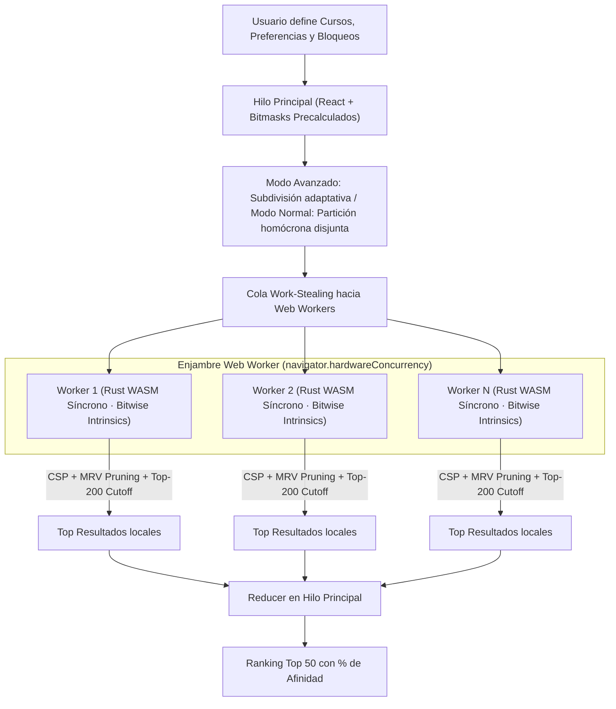
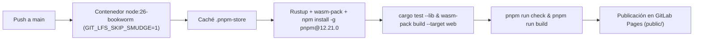

# 🏛️ MatrícuLAB 2.0 — Ecosistema Académico UTEC

<div align="center">


**Plataforma integral de planificación universitaria para la Universidad de Ingeniería y Tecnología (UTEC): armador de horarios con motor combinatorio en Rust WebAssembly y visualizador cuántico aleatorio, malla curricular interactiva de 16 carreras, catálogo de cursos con jerarquía de secciones/subsecciones y oyentes, radar de aulas consciente de fechas reales, directorio docente, red de mentores, paleta global `⌘K` y motor de navegación y gestos nativo multidispositivo.**

[Estética Grafton Swiss](#-sistema-visual-polychrome-grafton-swiss-concrete) • [Módulos del Ecosistema](#-módulos-del-ecosistema) • [Animaciones y Motor Cuántico](#-animaciones-e-interfaz-dinámica) • [Navegación y Gestos](#-motor-de-gestos-nativo-navegación-y-paleta-k) • [Motor QuantumEngine](#-arquitectura-y-motor-de-optimización-quantumengine) • [Estructura](#-estructura-del-proyecto) • [Instalación](#-instalación-y-desarrollo-local)

</div>

---

## 📌 ¿Qué es MatrícuLAB 2.0?

**MatrícuLAB 2.0** reúne **seis módulos académicos interconectados** dentro de una sola aplicación híbrida de transición instantánea (`0ms`) bajo [`AppShell.tsx`](src/components/AppShell.tsx):

1. **📅 Armador y Optimizador de Horarios (`/`):** Planificación semanal interactiva (`07:00` – `22:00`, lunes a sábado), detección de cruces en vivo, pestañas multi-escenario, bloqueador táctil de tiempo libre, importación local de documentos oficiales de UTEC y optimización combinatoria multihilo (**Web Workers + Rust WebAssembly**) hasta los **50 mejores horarios**, acompañada de un osciloscopio en vivo (`QuantumEngineVisualizer`) que anima combinaciones aleatorias ilimitadas del pool de cursos.
2. **🗺️ Malla Curricular Interactiva (`/malla`):** Grafo Acíclico Dirigido (DAG) 2D con las **16 carreras de pregrado de UTEC** (`200` créditos c/u a lo largo de `10` ciclos y `4` facultades), cálculo de desbloqueo de prerrequisitos y ruta crítica con arrastre inercial y ajuste compacto al `72%`.
3. **📚 Catálogo de Cursos y Hub de Oyentes (`/cursos`):** Explorador de **420 cursos ofertados** y **1,045 secciones/subsecciones activas** (`2026-2`) con jerarquía inteligente de secciones principales y subsecciones de laboratorio/teoría, cruce automático frente a reservas reales de campus, radar `En clase ahora`, grilla semanal compartida y flujo de solicitud para asistir como oyente.
4. **🏫 Buscador de Aulas Libres Consciente de Fechas (`/aulas`):** Disponibilidad de **99 espacios físicos válidos** (`Piso 1` al `Piso 10`) respaldada por **24,172 eventos reales de intranet** consolidados a lo largo de **16 semanas** (`01/08/2026` – `31/12/2026`) en **3,918 sesiones** (**1,594 recurrentes** + **2,324 esporádicas / eventos por fecha**).
5. **👨‍🏫 Directorio de Docentes (`/profesores` y `/docentes`):** Consulta académica de **392 docentes** con radar en vivo (`Dictando Ahora`), horas semanales, mapeo exacto de pisos, nomenclatura departamental corregida (`CC` → *Ciencias*), copiado rápido de correo `@utec.edu.pe` y grilla semanal individual.
6. **🏅 Mentores Académicos (`/mentores`):** Directorio de **31 mentores estudiantiles** con filtros táctiles por carrera y curso, estadísticas y ficha detallada.

---

## 🎨 Sistema Visual: Polychrome Grafton Swiss Concrete

La interfaz adopta una estética arquitectónica inspirada en la materialidad de concreto expuesto del campus de Barranco (Grafton Architects) y la retícula suiza de alta densidad:

* **Concreto Calizo y Grilla Grafito (`0px` Ortogonal):** Superficies en tonos alabastro cálido (`#EAE7E1` / `#F2F0EC`), retículas estructurales con bordes continuos (`#18181A`) sin desenfoques ni radios redondeados superfluos, y tipografía técnica tripartita (**Space Grotesk**, **Inter** y **JetBrains Mono**).
* **Sistema Policromático por Facultad (`getFacultyPolychrome`):** Identidad cromática determinista compartida entre tarjetas de cursos, docentes, aulas, malla curricular y modales:
  * **Computación y Ciencia de Datos (`CS`, `DS`, `SI`, `CY`):** Cobalto Técnico (`#005A8C` / `#F0F6FA`)
  * **Ingenierías (`PI`, `IN`, `ME`, `MT`, `EL`, `CI`, `IQ`, `BI`, `AM`, `EN`):** Terracota / Bermellón (`#B8332A` / `#FDF2F1`)
  * **Departamento Académico de Ciencias (`CC`, `MA`, `FI`, `QU`, `EG`):** Ocre Arquitectónico (`#B86200` / `#FDF6EC`)
  * **Negocios, Administración y Humanidades (`AD`, `BA`, `GI`, `HH`, `GH`):** Índigo Pizarra (`#3D348B` / `#F3F2FA`)
* **Pigmentos de Horario (`GRAFTON_PIGMENTS`):** Paleta mate de 8 pigmentos por código completo de curso (`cobalt`, `emerald`, `ochre`, `violet`, `crimson`, `cyan`, `olive`, `slate`) con trama diagonal para laboratorios, compartida coherentemente entre la grilla semanal (`TimetableGrid.tsx`), barra lateral de cursos, tarjetas, exportación PNG y las combinaciones del motor cuántico (`QuantumEngineVisualizer.tsx`), asegurando máxima variedad visual incluso entre cursos del mismo prefijo (`CS`/`CC`).
* **Micro-Tickets Suizos Móviles (`< 640px`):** En vista semanal estrecha (`Semana`), cada bloque muestra exclusivamente **código (`CS2023`)**, **sesión (`LAB 11` / `TEO 1`)** y **aula canónica corta (`A708`, `M803`, `MAG`, `VIR`)**; tocar cualquier bloque despliega la barra inspectora inferior (`mobile-course-inspector-strip`) con el detalle completo y opción rápida de quitar o inspeccionar.

---

## ✨ Módulos del Ecosistema

### 1. 📅 Armador y Optimizador de Horarios (`/`)
* **Grilla Semanal de Alta Densidad (`TimetableGrid.tsx`):** Vista completa de lunes a sábado (`07:00` – `22:00`), resaltado instantáneo de cruces (`ConflictBanner.tsx`), previsualización *hover* desde la barra lateral (`CourseSidebar.tsx`) y conmutación entre vista semanal y vista por día.
* **Armador de Semestre (Modo Avanzado y Modo Normal) (`ScheduleOptimizerModal.tsx`):** Selector de **cursos totales a llevar (`1`–`8`)** con slider multiplataforma compatible con WebKit y Firefox (`::-moz-range-track`, `::-moz-range-progress`, `::-moz-range-thumb`), relleno de progreso y ticks numéricos clicables, además de ventana horaria (`Hora Inicio` / `Hora Fin`), almuerzo garantizado (`lunchConfig` en camelCase), secciones fijadas (`pinnedSections`), calendario de bloqueos táctil (*Modo Estricto* o flexible) y botón **Detener Búsqueda** accesible en **móvil, tablet y escritorio**.
* **Ficha Estudiantil Colapsable en Móvil (`StudentBanner.tsx`):** Resume los metadatos del alumno en una franja compacta de 1 línea en `< 768px` expandible bajo demanda para maximizar el área vertical útil del horario.
* **Pestañas Multi-Escenario (`MultiScheduleTabs.tsx`):** Crea, renombra, duplica y compara múltiples propuestas en paralelo (`Opción 1 · Mañanas compactas`, `Opción 2 · Tardes libres`, etc.).
* **Bloqueador de Tiempo (`TimeBlockerGrid.tsx`):** Pinta franjas no disponibles mediante arrastre de mouse o deslizando un dedo en pantallas táctiles; el optimizador las respeta como restricciones duras o flexibles (*Modo Estricto*).
* **Importación Local de Documentos UTEC (`FileUploadModal.tsx`):**
  * **Excel (`Consulta_Horario.xlsx`):** Lector `xlsx` con enriquecimiento frente a eventos reales de aulas (`enriched_courses.json`) para depurar subsecciones canceladas.
  * **PDF de Carga Hábil y Consolidado (`pdfjs-dist`):** Extracción en el navegador de datos del alumno y clasificación automática en **Obligatorios**, **Electivos** y **Habilitados**.
* **Exportación (`ExportModal.tsx` y `GoogleCalendarModal.tsx`):** Captura PNG de alta resolución (`pngExporter.ts`), descarga estándar iCalendar `.ics` (RFC 5545) y sincronización directa con **Google Calendar (OAuth 2.0)** generando eventos recurrentes semestrales.

### 2. 🗺️ Malla Curricular Interactiva (`/malla`)
* **16 Mallas Oficiales UTEC (`utecCurriculaData.ts`):** Incluye los planes de **200 créditos** y **10 ciclos** de las 4 facultades (*Computación*, *Negocios*, *Ingeniería* y *Ciencias*): *Ciencia de la Computación*, *Ciencia de Datos e Inteligencia Artificial*, *Sistemas de Información*, *Ciberseguridad*, *Administración y Negocios Digitales*, *Business Analytics*, *Ingeniería Industrial*, *Bioingeniería*, *Ingeniería de la Energía*, *Ingeniería Mecánica*, *Ingeniería Química*, *Ingeniería Ambiental*, *Ingeniería Civil*, *Ingeniería Electrónica*, *Ingeniería Mecatrónica* y *Física*.
* **Grafo de Prerrequisitos y Simulación (`CurricularDAGView.tsx`):** Marca cursos aprobados para calcular créditos acumulados, cursos recién desbloqueados, cadenas de ruta crítica y visualización con líneas Bezier cúbicas.
* **Navegación 2D Fluida:** Arrastra libremente sobre `#dag-scroll-container` con inercia, haz zoom con `Ctrl`/`Meta` + rueda del ratón o usa los controles de la barra superior (incluyendo ajuste panorámico a escala **72%**).

### 3. 📚 Catálogo de Cursos y Hub de Visitantes (`/cursos`)
* **Catálogo Sincronizado:** **`420` cursos** y **`1,045` secciones/subsecciones** (`courses_catalog.json`) filtrables por día, carrera/departamento (con `CC` correctamente asignado a **Ciencias**), modalidad (*Presencial* / *Virtual*), en vivo ahora (`En clase ahora`) y cursos guardados en **Mis Visitados**.
* **Jerarquía de Secciones y Subsecciones (`sectionHierarchy.ts`, `CourseCard.tsx`, `CourseDetailModal.tsx`, `CourseTimetable.tsx`):**
  * Detecta automáticamente cursos **planos**, cursos con **1 sección principal y subsecciones** (51 cursos, como *Álgebra Lineal* `CC1103`, donde todos los laboratorios comparten una misma teoría general) y cursos con **múltiples secciones principales que contienen subsecciones** (30 cursos, como *Ciencia de los Materiales* `CC1143` o *Álgebra Lineal* `CC6105`).
  * En **Malla Horaria Semanal**, muestra tiras diferenciadas: `SEC. 1 · SUBSECCIONES:` (`Lab 11`…`Lab 17`) para sección única con subsecciones, o una jerarquía de **2 niveles** (`SECCIONES:` con conteo `4 sub` → `SUBSECCIONES:` agrupadas o filtradas por sección activa).
  * Deduplica sesiones teóricas compartidas tanto en vista global (`ALL`) como al aislar una sección (`MAIN:X`), etiquetándolas con códigos compactos (`S01·7s`, `S01·4s`, `SEC 01 · 7 SUBS`, `General S1`) distintos a los bloques individuales (`S01·L13`, `S02·T21`, `S02·T22`) y mostrando badges `Subsec.` en `Secciones y Aulas` y `SUBSECS (S1)` / `SUBSECS (2S)` en las tarjetas.
* **Hub de Oyentes (`VisitorEmailModal.tsx`):** Redacta solicitudes formales dirigidas al correo institucional (`@utec.edu.pe`) del docente y permite abrirlas directamente en el cliente de correo predeterminado (`mailto:`), Gmail Web o copiarlas al portapapeles.

### 4. 🏫 Buscador de Aulas Libres Consciente de Fechas (`/aulas`)
* **Dataset Semestral Real (`2026-2`):** Recopilado directamente del portal de reservas de UTEC entre el **`01/08/2026`** y **`31/12/2026`** (`16` semanas, **`24,172` eventos brutos** consolidados en **`3,918` sesiones**: `1,594` recurrentes y `2,324` esporádicas).
* **Modo Fecha Exacta vs. Semestre General:** Consulta la disponibilidad real de un aula para una fecha específica del calendario (detectando reservas extraordinarias, exámenes o talleres puntuales) o revisa su patrón semanal consolidado.
* **Inventario Depurado (`99` Aulas Válidas del Piso 1 al Piso 10):** Abarca salones estándar (`A`), mesas de aprendizaje activo (`M`), laboratorios de especialidad (`L`, incluyendo `L301` id `3059`), auditorios y espacios especiales. Descarta automáticamente aulas ficticias (`A701-A` / id `2814` y variantes terminadas en `-A`), cubículos de estudio (`E801`–`E810`), áreas deportivas no académicas y el registro externo `L203E`.
* **Contadores Reactivos por Piso (`ClassroomFilterBar.tsx`):** Las píldoras de `Piso 1` a `Piso 10` recalculan al instante el número de ambientes disponibles según tipo de espacio, ventana mínima libre y búsqueda.

### 5. 👨‍🏫 Directorio de Docentes (`/profesores` y `/docentes`) & 6. 🏅 Mentores (`/mentores`)
* **392 Docentes (`professors_catalog.json`):** Radar de dictado en tiempo real, resumen de carga horaria semanal, departamento `CC` mapeado a **Ciencias**, enlace directo de aulas al buscador `/aulas`, correo `@utec.edu.pe` y grilla semanal interactiva (`ProfessorTimetable.tsx`) exportable en `.ics`.
* **31 Mentores Académicos (`mentores_academicos.json` / `mentorsData.ts`):** Perfiles detallados con rol, ciclo, carrera, cursos asesorados y barra de filtros responsiva.

---

## 🎞️ Animaciones e Interfaz Dinámica

### Animaciones de Combinaciones en el Motor Cuántico (`QuantumEngineVisualizer.tsx`)
Mientras los Web Workers y Rust WebAssembly evalúan el espacio de búsqueda, el visualizador proyecta un tablero osciloscopio vivo con **estados combinatorios aleatorios ilimitados** y coherencia visual con la grilla manual:
* **Generador Procedural Aleatorio y Paleta de 8 Pigmentos (`generateRandomCandidateFrame`):** Cada ciclo (`~170 ms` / 2 ticks de `85 ms`) muestrea aleatoriamente entre **5 y 8 cursos** del pool seleccionado (priorizando los cursos fijados) y colorea cada bloque por su código completo con `getGraftonPigment(courseCode)` (idéntico al tablero semanal). Al completar los workers, garantiza un mínimo ágil de `300 ms` de exposición visual antes de mostrar las tarjetas óptimas, con **Detener Búsqueda** disponible en móvil, tablet y desktop (`worker.terminate()`).
* **Simulación Viva de Ramas Válidas y Podadas:** Alterna de manera aleatoria entre candidatos sin colisión (`[OK ✓]` / `[TEST]` → `BITMASK AND == 0x0000 · VÁLIDO`) y ramas con cruces superpuestos (`[CRUCE X]` con `z-index` prioritario y trama diagonal carmesí → `PODA BITMASK · RAMA DESCARTADA`). Al completarse la búsqueda (`isComplete`), bloquea de inmediato una rama óptima libre de cruces.
* **Bitmasks 64-Bit y Cubo 3×3 Sincronizados:** Los registros binarios inferiores (`[LUN: ...] .. [SÁB: ...]`) reflejan las filas ocupadas y colisiones del estado actual generado, acompañados por el barrido horizontal del láser (`swissScanSweep`), un cubo permutador 3×3 aleatorio cada `85 ms` y una barra de progreso de 24 segmentos.

### Animaciones de Modales, Tarjetas y Controles
* **Modales con Portal a `document.body`:** Se renderizan fuera de contenedores con `transform` para no romper `position: fixed` en iOS/Safari, usando animaciones de entrada suave (`modalScaleUp` / `scaleUp` en escritorio y `sheetSlideUp` tipo hoja inferior en móvil).
* **Física Táctil de Cierre y Swipe:** En móvil (`< 768px`), arrastrar un modal hacia abajo atenúa progresivamente el *backdrop* y aplica rebote elástico (`cubic-bezier(0.22, 1, 0.36, 1)`) si no supera el umbral de cierre (`> 105px` o `> 0.45 px/ms`). En `/cursos`, deslizar horizontalmente una tarjeta revela las bandejas `★ OYENTE` o `HORARIO →`.
* **Micro-animaciones de Estado:** Pulsos en vivo (`liveBeaconPulse`, `pulse-dot`), carrusel de cursos en docentes (`profCarouselTicker`), notificaciones deslizantes (`graftonToastSlideIn`) e interpolación fluida en el indicador del dock móvil (`.grafton-dock-slider`).

---

## 🕹️ Motor de Gestos Nativo, Navegación y Paleta `⌘K`

MatrícuLAB 2.0 combina **navegación SPA instantánea (`0ms`)** con un sistema unificado de gestos táctiles, puntero y teclado que respeta el scroll vertical nativo:

| Dispositivo / Contexto | Interacción / Mecanismo | Comportamiento |
| :--- | :--- | :--- |
| **Navegación SPA (`AppShell.tsx`)** | **Transición `0ms` + Estado Persistente** | Intercepta clics internos con `history.pushState` entre `/`, `/malla`, `/cursos`, `/aulas`, `/profesores` y `/mentores`, mantiene montados los módulos visitados, preserva la posición de scroll por pestaña y realiza *prefetch* proactivo de rutas y precarga diferida de catálogos (`requestIdleCallback`). |
| **Enlaces Profundos Cruzados** | **Deep-Linking entre Módulos** | Tocar cualquier aula o docente dentro de un horario, curso o tarjeta navega sin recargar a `/aulas?aula=...` o `/profesores?profesor=...` abriendo el filtro o detalle correspondiente. |
| **Móvil y Tablet (`< 1024px`)** | **Deslizamiento de Página 1:1** | Desliza horizontalmente entre `/`, `/cursos`, `/aulas`, `/profesores` y `/mentores` con bloqueo direccional (`1.35x`), amortiguamiento elástico en extremos (`0.18`), interpolación continua del indicador de `.grafton-mobile-dock` y paralaje de contenido (`±56px`). Respeta zonas `[data-no-page-swipe]` y contenedores `.overflow-x-auto`. |
| **Móvil (`< 1024px`)** | **Magnetic Dock Scrubbing** | Arrastra el pulgar directamente sobre la barra inferior para recorrer módulos con un indicador flotante superior (`[ HORARIOS ]`, `[ CURSOS ]`, `[ AULAS ]`, `[ DOCENTES ]`, `[ MENTORES ]`). |
| **Móvil (`< 768px`)** | **Swipe en Tarjetas y Bottom-Sheets** | Deslizar tarjetas de curso a izquierda/derecha ejecuta acciones rápidas; arrastrar la manija superior (`grafton-modal-drag-handle`) cierra cualquier modal hacia abajo. |
| **Horarios (`TimetableGrid` & `TimeBlockerGrid`)** | **Double-Tap / Pinch Zoom & Pintura Táctil** | Doble toque o pellizco de 2 dedos sobre encabezados/columnas alterna entre `Semana` y Vista de Día Único; un dedo sobre la grilla de bloqueos pinta o redimensiona bloques libres. |
| **Malla DAG (`/malla`)** | **2D Canvas Grab-to-Pan & Zoom** | Arrastre inercial 2D del grafo de `10` ciclos, zoom con `Ctrl`/`Meta` + rueda y botón de ajuste rápido (`72%`). |
| **Escritorio / Global** | **Paleta `⌘K` / `Ctrl+K` y Atajos `←`/`→`/`J`/`K`** | [`CommandPalette.tsx`](src/components/CommandPalette.tsx) indexa al instante los **420 cursos**, **392 docentes**, **99 aulas**, **16 mallas** y acciones rápidas. En `/` y en el Optimizador, las teclas `←` / `K` y `→` / `J` navegan entre pestañas y resultados (`#1 / 50`). |

---

## 🧠 Arquitectura y Motor de Optimización (`QuantumEngine`)

El optimizador (`ScheduleOptimizerModal.tsx`) resuelve el Problema de Satisfacción de Restricciones (**CSP**) combinando Web Workers paralelos con código nativo compilado a **WebAssembly síncrono de máximo rendimiento** (~`114 KB` compilado con `opt-level = 3`, `lto = true`, `codegen-units = 1` y `panic = "abort"`):



1. **Ejecución WASM 100% Síncrona sin *Timer Clamping* (`sleep(0)` eliminado):** Cada Web Worker corre `compute_chunk` de manera totalmente síncrona sin depender de `gloo-timers` ni `setTimeout(0)`, evitando pausas del navegador y logrando saturación continua de CPU en todos los hilos activos. El progreso se reporta de forma no bloqueante cada `~80 ms` (`SearchState::tick_progress`) y la cancelación es inmediata mediante `worker.terminate()`.
2. **Pre-cálculo en `INIT`, Índices Enteros y Zero-Allocation (`wasm-engine/src/lib.rs`):** En `INIT`, `QuantumEngine::from_raw` prefiltra secciones fijadas (`pinnedSections`) y bloqueos estrictos (`blockedTimeMask`), precalcula la matriz plana de conflictos $O(N^2)$ y la máscara de almuerzo una sola vez, y asigna índices enteros (`usize`) para hacer DFS *in-place* sin búsquedas lineales de texto ni clonación de vectores en heap.
3. **Evaluación Hardware Bitwise e Interrupción Temprana Top-200:** Los bloques de `60 slots/día` (`u64`) calculan huecos, turno mañana/tarde, ventana de almuerzo (`free &= free >> 1`) y días puente mediante instrucciones nativas (`trailing_zeros`, `leading_zeros`, `count_ones`). Las hojas por debajo del `cutoff_200` se descartan antes de asignar métricas o `HashMap`s.
4. **Paralelismo Total en Modo Avanzado y Modo Normal:**
   * *Modo Avanzado:* Precomputa bitmasks una vez ($O(N \cdot S)$) en el hilo principal y subdivide dinámicamente las ramas más pesadas entre los workers (*work-stealing*).
   * *Modo Normal:* Reparte los grupos homócronos únicos de las asignaturas seleccionadas en filtros disjuntos (`sectionFilters`) entre todos los workers disponibles (con *warm-up* previo activo en ambos modos).
5. **Sistema de Puntuación Dual:** Evalúa huecos libres, días de asistencia, penalización de días puente, preferencia de turno (mañana/tarde), ventana de almuerzo (`lunchConfig` en camelCase) y penalización blanda de bloqueos, devolviendo los **50 mejores resultados** normalizados de `0%` a `100%`.

---

## ⚡ Arquitectura de Datos y Caché

* **Caché Multicapa ([`masterDataLoader.ts`](src/utils/masterDataLoader.ts)):** Jerarquía en tres niveles —memoria síncrona en ventana, `sessionStorage` versionado (`v7` con purga automática de versiones previas) y JSON estáticos precompilados en `public/data/`— con precarga diferida mediante `requestIdleCallback`.
* **Almacenamiento de Binarios (Git LFS):** El repositorio gestiona archivos `.mp4` (grabaciones de auditoría y tours de interfaz) mediante **Git Large File Storage** (`.gitattributes` rastreando `*.mp4`).

---

## 📁 Estructura del Proyecto

```text
Matricula/
├── .gitattributes                    # Reglas Git LFS (*.mp4) para activos de video
├── .gitlab-ci.yml                    # CI/CD: Rust WASM + pnpm check/build -> GitLab Pages
├── astro.config.mjs                  # Configuración de Astro v7.4, React y manualChunks
├── package.json                      # Dependencias y scripts (dev, build, check, scrape:aulas)
├── wasm-engine/                      # Motor combinatorio en Rust compilado a WebAssembly
│   ├── Cargo.toml
│   └── src/lib.rs                    # QuantumEngine (CSP, MRV, bitmasks u64, scoring)
├── scripts/                          # Pipeline CLI de catálogos, aulas y enriquecimiento
│   ├── buildCoursesCatalog.ts        # Genera courses_catalog.json, professors_catalog.json y enriched_courses.json
│   ├── buildMentorsData.ts           # Procesa mentores_academicos.json
│   ├── enrichClassrooms.ts           # Enriquecimiento cruzado oferta <-> aulas intranet
│   ├── scrapeAulasIntranet.ts        # Scraper diario/intervalos de aulas en intranet
│   ├── scrapeSemesterAvailability.ts # Consolidación semestral (24,172 eventos -> 3,918 sesiones)
│   └── README.md                     # Documentación de endpoints y taxonomía de aulas
├── docs_v2/                          # Especificación matemática y guías de v2
├── public/
│   ├── data/                         # Catálogos JSON estáticos precompilados
│   │   ├── classrooms_intranet.json
│   │   ├── classrooms_semester_consolidated.json
│   │   ├── courses_catalog.json
│   │   ├── enriched_courses.json
│   │   ├── mentores_academicos.json
│   │   └── professors_catalog.json
│   └── samples/                      # Archivo Consulta_Horario.xlsx de ejemplo
├── tests/                            # Suites Playwright de auditoría visual, UI, gestos y tours
│   ├── cc-reservas-subsections-audit.spec.ts
│   ├── deep-forensic-crawler.spec.ts
│   ├── grafton-50-results-and-quantum-audit.spec.ts
│   ├── run-course-modal-grid-audit.cjs
│   ├── record-auditory-videos.cjs
│   ├── record-full-9min-tours.cjs
│   └── record-gesture-showcase.cjs
└── src/
    ├── pages/                        # Rutas Astro (/, /cursos, /malla, /aulas, /profesores, /docentes, /mentores, /privacy, /terms)
    ├── data/
    │   ├── mentorsData.ts
    │   └── utecCurriculaData.ts      # 16 carreras UTEC de 200 créditos y 10 ciclos
    ├── styles/
    │   ├── graftonSwissSystem.css    # Sistema visual Polychrome Grafton Swiss Concrete + Jerarquías + Gestos
    │   ├── main.css                  # Tokens, sliders cross-browser (WebKit/Firefox) y QuantumEngineVisualizer
    │   ├── courses.css
    │   ├── classrooms.css
    │   ├── professors.css
    │   ├── mentors.css
    │   └── customPickers.css
    ├── types/                        # Contratos TypeScript (schedule, courseDirectory, classroom, professor, mentor)
    ├── utils/
    │   ├── masterDataLoader.ts       # Caché en memoria, sessionStorage (v7) y carga JSON
    │   ├── sectionHierarchy.ts       # Agrupación y etiquetas de secciones vs subsecciones
    │   ├── graftonPigments.ts        # Paleta arquitectónica de 8 pigmentos para bloques horarios
    │   ├── scheduleUtils.ts          # Bitmasks, conflictos y getFacultyPolychrome
    │   ├── scheduleOptimizer.ts      # Evaluación heurística y desempates en TypeScript
    │   ├── scheduleWorker.ts         # Enjambre de Web Workers conectado a wasm-engine
    │   ├── excelParser.ts            # Procesamiento local de Consulta_Horario.xlsx
    │   ├── pdfParser.ts              # Extractor local de Carga Hábil y Consolidado PDF
    │   ├── courseDirectoryUtils.ts   # Utilidades de catálogo, cursos y .ics
    │   ├── classroomUtils.ts         # Motor de disponibilidad consciente de fechas y pisos
    │   ├── professorUtils.ts         # Agregación de carga docente, dept. Ciencias (CC) y correos
    │   ├── mentorUtils.ts            # Filtrado y métricas de mentores
    │   ├── googleCalendarService.ts  # Cliente OAuth 2.0 para Google Calendar API
    │   ├── icsExporter.ts            # Generador RFC 5545 (.ics)
    │   └── pngExporter.ts            # Exportación PNG en alta resolución
    └── components/
        ├── AppShell.tsx              # Contenedor SPA 0ms, teclado y drag-to-dismiss móvil
        ├── CommandPalette.tsx        # Paleta global ⌘K / Ctrl+K
        ├── GraftonTopBar.tsx         # Barra superior desktop con botón ⌘K y acciones
        ├── MobileBottomNav.tsx       # Dock policromático + swipe 1:1 + magnetic scrubbing
        ├── ScheduleApp.tsx           # Estado principal del armador y atajos de pestañas
        ├── TimetableGrid.tsx         # Grilla horaria + Micro-Tickets móviles + double-tap/pinch
        ├── TimeBlockerGrid.tsx       # Grilla táctil y de escritorio para franjas bloqueadas
        ├── ScheduleOptimizerModal.tsx# Optimizador 2.0, slider cross-browser y cycling ←/→/J/K
        ├── QuantumEngineVisualizer.tsx # Osciloscopio cuántico con combinaciones aleatorias ilimitadas
        ├── CourseSidebar.tsx
        ├── StudentBanner.tsx
        ├── MultiScheduleTabs.tsx
        ├── ExportModal.tsx
        ├── FileUploadModal.tsx
        ├── GoogleCalendarModal.tsx
        ├── CurricularGraph/          # CurricularDAGView.tsx (DAG 2D de 16 carreras)
        ├── CourseDirectory/          # Módulo /cursos, CourseTimetable.tsx y VisitorEmailModal.tsx
        ├── ClassroomFinder/          # Módulo /aulas
        ├── ProfessorDirectory/       # Módulo /profesores
        ├── MentorDirectory/          # Módulo /mentores
        └── common/                   # Selectores, KPI bands e iconos reutilizables
```

---

## 🛠️ Stack Tecnológico

| Categoría | Tecnología | Propósito en MatrícuLAB 2.0 |
| :--- | :--- | :--- |
| **Framework Principal** | [Astro](https://astro.build/) `v7.4.12` | Generación estática SSG y empaquetado optimizado con `manualChunks` |
| **Interfaz Reactiva** | [React](https://react.dev/) `19.3` + [TypeScript](https://www.typescriptlang.org/) `7.1` | Módulos interactivos, grillas densas, gestos táctiles y tipado estricto |
| **Motor Combinatorio** | [Rust](https://www.rust-lang.org/) + [WebAssembly](https://webassembly.org/) | `QuantumEngine`: backtracking CSP, bitmasks `u64` y ranking sin pausa GC |
| **Concurrencia** | Web Workers API | Procesamiento paralelo Map-Reduce sobre `navigator.hardwareConcurrency` |
| **Procesamiento Local** | `pdfjs-dist` `3.11` & SheetJS `xlsx` `0.18` | Lectura 100% client-side de Carga Hábil, Consolidado y Oferta Excel |
| **Exportación y Calendarios** | Google Calendar API (OAuth 2.0), `html2canvas` & `.ics` | Sincronización semestral, exportación PNG de alta densidad y eventos RFC 5545 |
| **Sistema Visual** | CSS Grid, `dvh`, `lucide-react` & `Grafton Swiss Concrete` | Interfaz policromática de alta legibilidad optimizada para desktop, tablet y móvil |

---

## 🚀 Instalación y Desarrollo Local

### Requisitos Previos
* **Node.js**: `>= 22.12.0`
* **pnpm**: `>= 12.21.0` (`packageManager: pnpm@12.21.0`)
* **Git LFS**: requerido para descargar las grabaciones `.mp4` rastreadas en el repositorio (`git lfs install`)
* **Rust & `wasm-pack`** *(opcional, solo si recompilas `wasm-engine/`)*:
  ```bash
  curl --proto '=https' --tlsv1.2 -sSf https://sh.rustup.rs | sh
  curl https://rustwasm.github.io/wasm-pack/installer/init.sh -sSf | sh
  ```

### Pasos

1. **Clonar el repositorio (con Git LFS):**
   ```bash
   git lfs install
   git clone git@github.com:farsep/utec-scheduler.git
   cd utec-scheduler
   ```

2. **Probar y compilar el motor Rust a WebAssembly *(opcional si ya existe `wasm-engine/pkg`)*:**
   ```bash
   cd wasm-engine
   cargo test --lib
   wasm-pack build --target web
   cd ..
   ```

3. **Instalar dependencias y verificar tipos:**
   ```bash
   pnpm install
   pnpm run check
   ```

4. **Iniciar el servidor de desarrollo:**
   ```bash
   pnpm dev
   ```
   > Disponible localmente en `http://localhost:4321`.

5. **Generar y previsualizar el build de producción:**
   ```bash
   pnpm run build
   pnpm preview
   ```

---

## 🔄 Pipeline de CI/CD (GitLab Pages)

El despliegue continuo definido en [`.gitlab-ci.yml`](.gitlab-ci.yml) valida los tests de Rust, compila el motor WebAssembly y publica la aplicación estática en **GitLab Pages** al actualizar la rama `main`:



1. **Entorno Base y LFS:** Imagen `node:26-bookworm` con `GIT_LFS_SKIP_SMUDGE: "1"` (evita descargar los `.mp4` de auditoría/tours innecesarios para el build) y caché de `.pnpm-store` indexado por `pnpm-lock.yaml`.
2. **Toolchain WASM + `pnpm`:** Instala Rustup y `wasm-pack`, e instala dinámicamente la versión exacta de `pnpm` declarada en `"packageManager"` de [`package.json`](package.json) (`pnpm@12.21.0`) mediante `npm install -g` (ya que Node 26 no incluye Corepack).
3. **Tests, WASM y Build:** Ejecuta `cargo test --lib` y `wasm-pack build --target web` en `wasm-engine/`, luego `pnpm install --frozen-lockfile --store-dir .pnpm-store`, `pnpm run check` (`astro sync && tsc --noEmit --runExternalCode`) y `pnpm run build` hacia `dist/`, publicándolo como artefacto de Pages en `public/`.

---

## 🔒 Privacidad y Seguridad

* **Procesamiento 100% Client-Side:** Los archivos de Carga Hábil, Consolidado de Matrícula y Excel se leen íntegramente en la memoria del navegador sin subirse a ningún servidor.
* **Sin Bases de Datos Externas:** Tus horarios armados, cursos marcados como visitante y bloqueos personales se almacenan localmente en tu dispositivo.
* **OAuth 2.0 Directo:** La sincronización con Google Calendar utiliza tokens efímeros emitidos directamente por Google en tu sesión del navegador.

---

<div align="center">

Hecho con ❤️ para la comunidad estudiantil de **UTEC**.

</div>
