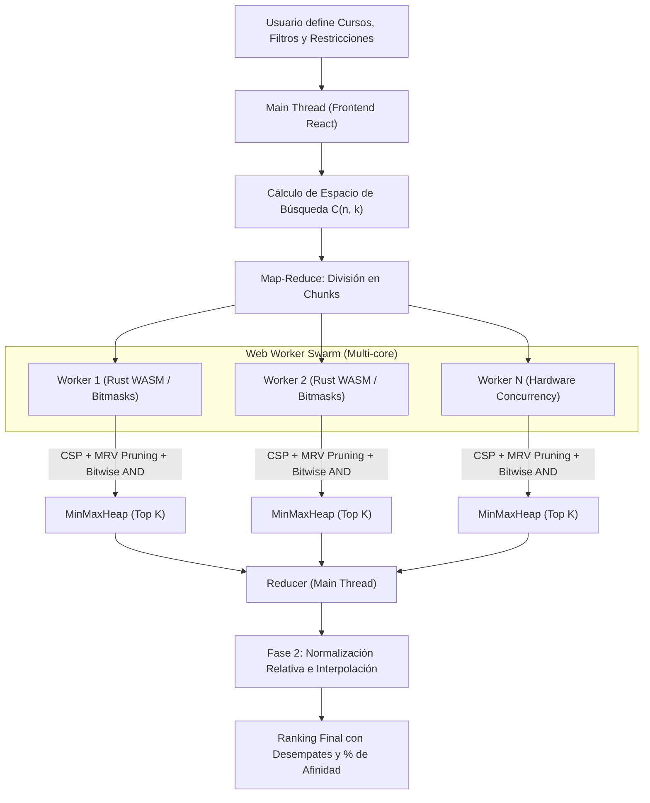
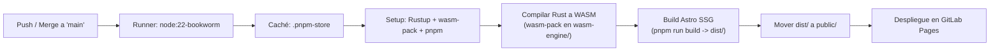

# 🎓 MatrícuLAB 2.0 — Ecosistema Académico y Optimizador Inteligente de Horarios UTEC

<div align="center">


**La plataforma integral para planificar y optimizar horarios algorítmicamente, explorar el catálogo de cursos como oyente, ubicar aulas libres en tiempo real, consultar horarios docentes y conectar con mentores académicos en la Universidad de Ingeniería y Tecnología (UTEC).**

[Módulos del Ecosistema](#-módulos-del-ecosistema) • [Motor Algorítmico](#-arquitectura-y-motor-de-optimización) • [Arquitectura SPA y Caché](#-arquitectura-de-navegación-instantánea-y-datos) • [Estructura del Proyecto](#-estructura-del-proyecto) • [Instalación](#-instalación-y-desarrollo-local) • [CI/CD](#-pipeline-de-cicd-gitlab-pages) • [Privacidad](#-privacidad-y-seguridad)

</div>

---

## 📌 ¿Qué es MatrícuLAB?

**MatrícuLAB 2.0** es una plataforma web de alto rendimiento diseñada por y para la comunidad estudiantil de **UTEC**. Nacida originalmente para resolver el problema combinatorio de armar horarios sin cruces durante la matrícula, hoy integra **cinco módulos académicos interconectados** bajo una arquitectura instantánea:

1. **📅 Armador y Optimizador de Horarios (`/`):** Planificación manual e inteligencia combinatoria multihilo (**Web Workers + Rust WebAssembly**) que evalúa millones de combinaciones en milisegundos.
2. **📚 Catálogo de Cursos y Hub de Visitantes (`/cursos`):** Explorador completo de la oferta académica con malla horaria por curso y herramientas para asistir como estudiante visitante (*oyente*).
3. **🏫 Buscador de Aulas Libres (`/aulas`):** Radar en tiempo real de salones, laboratorios y espacios disponibles por piso y franja horaria en el campus.
4. **👨‍🏫 Directorio de Docentes (`/profesores`):** Buscador de profesores con ubicación en vivo en el campus, carga horaria semanal, cursos dictados y malla horaria individual.
5. **🏅 Mentores Académicos (`/mentores`):** Directorio de mentores estudiantiles filtrable por carrera, ciclo y cursos de especialidad.

---

## ✨ Módulos del Ecosistema

### 1. 📅 Armador Manual e Interactivo de Horarios (`/`)
* **Grilla Semanal de Alta Densidad:** Visualización de lunes a sábado (`07:00` a `22:00`) con bloques codificados cromáticamente por curso y detección automática de hora actual.
* **Detalle Completo de Sesión:** Visualización inmediata de modalidad, tipo de clase (*Teoría*, *Práctica*, *Laboratorio*), código de aula, docente asignado y vacantes.
* **Detección de Cruces en Tiempo Real:** Identificación instantánea de choques de horario con alertas contextuales y resaltado visual de las sesiones en conflicto.
* **Previsualización Dinámica (Hover Preview):** Pasa el cursor sobre cualquier sección del panel lateral para previsualizar en tiempo real cómo encajaría en tu semana antes de seleccionarla.
* **Pestañas Multi-Horario:** Crea, renombra, duplica y compara múltiples escenarios de matrícula (*Opción A*, *Opción B*, *Opción C*, etc.) en paralelo.
* **Bloqueador de Tiempo Personal (Time Blocker Grid):** Marca franjas horarias reservadas para trabajo, deporte, transporte o estudio; el optimizador respetará estrictamente estos bloques como restricciones duras.
* **Carga de Documentos Oficiales UTEC:**
  * **Excel de Oferta Académica (`Consulta_Horario.xlsx`):** Procesamiento completo de cursos, secciones, docentes, aulas y vacantes.
  * **PDF de Carga Hábil (Cursos Habilitados):** Extracción local mediante `pdfjs-dist` de tus datos de estudiante (*Nombre*, *Código*, *Carrera*, *Malla Curricular*), clasificando automáticamente tus cursos en **Obligatorios**, **Electivos** y **Habilitados**.
  * **PDF de Consolidado de Matrícula:** Importación directa de tu horario oficial matriculado.

---

### 2. ⚡ Optimizador Automático 2.0 (Motor Combinatorio)
Evalúa todas las permutaciones válidas de secciones y entrega un ranking ordenado por porcentaje de afinidad (`0%` a `100%`):

* **Modo Básico:** Selecciona los cursos exactos que deseas llevar y obtén las mejores combinaciones de secciones sin cruces.
* **Modo Avanzado — Bolsa Combinatoria $C(n,k)$:** Selecciona un conjunto amplio de cursos candidatos (por ejemplo, 10 cursos entre obligatorios y electivos) y define cuántos deseas cursar ($k$). El motor explora todas las sub-combinaciones posibles de $k$ cursos y sus respectivas secciones.
* **Fijado de Secciones (Pinning):** Fija un docente o sección específica en un curso para que el algoritmo construya el resto del horario alrededor de tu elección.
* **Criterios Heurísticos y Penalizaciones Configurables:**
  * **⚡ Menos huecos:** Minimiza los tiempos muertos entre bloques de clases de un mismo día.
  * **📅 Menos días de asistencia:** Compacta la carga académica en la menor cantidad de días posibles.
  * **🚫 Sin días puente:** Penaliza severamente (`-1000 pts`) horarios con días libres aislados entre días de clase (ej. asistir lunes y miércoles dejando martes vacío).
  * **🌅 Preferencia Mañana / 🌇 Preferencia Tarde:** Bonifica horarios concentrados antes o después de las `12:00`.
  * **🥪 Garantía de Almuerzo:** Define una ventana horaria (ej. `12:00` – `15:00`) y una duración mínima libre continua para asegurar tu hora de almuerzo todos los días.

---

### 3. 📚 Catálogo de Cursos y Hub de Visitantes / Oyentes (`/cursos`)
Explora los **409+ cursos ofertados** y más de **1,019 secciones** del semestre en una interfaz diseñada para descubrir clases y asistir como oyente:

* **Indicadores en Tiempo Real:** Muestra cuántos cursos tienen sesiones dictándose en este preciso instante (`En clase ahora`) con detalle de aula y hora de término.
* **Filtros Avanzados:** Búsqueda instantánea por código (`CC1101`, `CS2041`, etc.), nombre del curso, apellido del docente o número de aula; filtrado por **Carrera / Departamento**, **Día de la semana**, **Modalidad** (*Presencial* / *Sincrónico*) y filtros rápidos para **En vivo ahora** y **Mis Visitados**.
* **Malla Horaria Semanal por Curso (`CourseTimetable`):**
  * **Vista Matriz y Vista Agenda Diaria:** Visualiza todas las secciones del curso simultáneamente o filtra una sección específica mediante selector desplegable o píldoras horizontales deslizables.
  * **Fusión Inteligente de Clases Compartidas:** Agrupa automáticamente las sesiones teóricas magistrales compartidas por múltiples sub-secciones (ej. `Sec. 1 (4 grp)` en `Aula Magna`) para evitar bloques duplicados.
  * **Control de Superposición (`MAX_COLS = 3`) e Inspector Interactivo:** En cursos masivos (hasta 24 secciones), agrupa limpiamente las secciones paralelas con indicador `+X más` y un inspector inferior para alternar entre secciones, consultar el aula o agendar la sesión en Google Calendar.
  * **Rango Horario Dinámico y Salto Rápido por Día:** Ajusta automáticamente el eje vertical a las horas reales del curso y permite saltar a cualquier día con un toque en pantallas móviles.
* **Modo Oyente / Visitante:**
  * Guarda tus cursos de interés en **Mis Visitados** (persistido localmente).
  * **Generador de Solicitud de Permiso al Docente:** Redacta automáticamente una plantilla formal dirigida al correo institucional (`@utec.edu.pe`) del profesor de la sección elegida, lista para abrir en tu cliente de correo, Gmail Web o copiar al portapapeles.
  * **Exportación Directa:** Descarga el calendario `.ics` del curso o agenda sesiones individuales en Google Calendar.

---

### 4. 🏫 Buscador de Aulas Libres en Tiempo Real (`/aulas`)
Encuentra salones, laboratorios, auditorios y espacios desocupados en el campus de UTEC para estudiar en grupo o repasar antes de un examen:

* **Estado en Tiempo Real:** Clasifica cada espacio como **Libre ahora** (indicando hasta qué hora permanece libre o si está libre el resto del día), **Por desocuparse pronto** o **Ocupado** (mostrando qué curso, sección y docente están en clase).
* **Filtros por Piso y Duración:** Filtra por piso (`Piso 1` a `Piso 11`), tipo de espacio (*Aulas*, *Laboratorios*, *Auditorios*), tiempo libre mínimo requerido (`30m`, `1h`, `2h+`) o simula la disponibilidad en cualquier día y hora futura.
* **Línea de Tiempo Interactiva (`07:00` – `22:00`):** Barra visual en cada tarjeta que muestra las franjas libres (verde) y ocupadas (rojo/ámbar) a lo largo del día.
* **Modal de Ocupación Semanal (`ClassroomDetailModal`):** Consulta la matriz semanal completa de cualquier salón del campus.

---

### 5. 👨‍🏫 Directorio de Docentes (`/profesores` y `/docentes`)
Consulta el perfil académico y horario de todos los profesores que dictan en el semestre:

* **Radar "En Clase Ahora":** Identifica al instante qué docentes se encuentran dictando clase en este momento y en qué aula del campus se ubican.
* **Métricas por Docente:** Total de horas semanales de dictado, número de cursos distintos, secciones a cargo, días activos en el campus y distribución por modalidad.
* **Contacto Institucional:** Generación y validación automática del correo institucional (`@utec.edu.pe`) con botón de copiado rápido.
* **Malla Horaria Docente (`ProfessorTimetable`):** Visualiza la semana completa del profesor en modo **Matriz** o **Agenda Diaria**, navega hacia los cursos o aulas asociadas con un clic y exporta su horario en formato `.ics`.

---

### 6. 🏅 Directorio de Mentores Académicos (`/mentores`)
Conecta con estudiantes mentores de ciclos superiores para recibir acompañamiento académico y orientación universitaria:

* **Búsqueda y Filtros Especializados:** Filtra mentores por **Carrera**, **Curso que domina** o busca por nombre.
* **Tarjetas y Perfil Detallado (`MentorDetailModal`):** Fotografías, ciclo actual, insignia de rol (*Mentor* / *Coordinador*), biografía, frase motivacional, lista de cursos en los que brinda mentoría y acceso directo a contacto.

---

### 7. 📤 Exportación e Integración con Calendarios
* **📅 Sincronización con Google Calendar (OAuth 2.0):** Conecta tu cuenta de Google para crear automáticamente eventos recurrentes semanales durante todo el ciclo académico, incluyendo código de aula, nombre del docente y colores diferenciados.
* **📆 Estándar iCalendar (`.ics`):** Descarga archivos `.ics` compatibles con Apple Calendar, Microsoft Outlook, Notion Calendar y Google Calendar desde el armador de horarios, el catálogo de cursos o el directorio de docentes.
* **🖼️ Captura PNG en Alta Definición:** Exporta tu horario semanal como una imagen limpia en alta resolución mediante `html2canvas`, ideal para fondo de pantalla o compartir con amigos.

---

## 🧠 Arquitectura y Motor de Optimización

El núcleo algorítmico de **MatrícuLAB 2.0** resuelve el problema de satisfacción de restricciones (**CSP**) combinando paralelismo en el cliente y compilación nativa a **WebAssembly**:



### 1. CSP (Constraint Satisfaction Problem) y Heurística MRV
En lugar de evaluar combinaciones por fuerza bruta, el motor ordena los cursos aplicando la heurística **Minimum Remaining Values (MRV)**: prioriza aquellos cursos con menor cantidad de secciones válidas (mayor restricción). Si una sección colisiona con el horario acumulado o con el bloqueador de tiempo, el algoritmo **poda la rama completa del árbol**, descartando millones de estados inválidos en una sola operación.

### 2. Detección de Colisiones en $O(1)$ mediante Bitmasks
Cada horario semanal se codifica como una máscara de bits sobre enteros de 64 bits (`BigInt` / `u64`), donde cada bit representa un bloque temporal de la semana. Verificar si dos secciones o franjas bloqueadas se cruzan se reduce a una operación lógica a nivel de CPU:

$$\text{colision} = (\mathbf{mask}_A \land \mathbf{mask}_B) \neq 0$$

```typescript
const hayColision = (maskA & maskB) !== 0n;
```

### 3. Enjambre de Web Workers + Rust WASM (`QuantumEngine`)
* **Web Worker Swarm:** Divide el espacio combinatorio $C(n,k)$ en particiones equilibradas y las distribuye entre tantos hilos paralelos como núcleos lógicos exponga el procesador (`navigator.hardwareConcurrency`).
* **QuantumEngine (`wasm-engine/`):** Motor escrito en **Rust** y compilado a **WebAssembly** que ejecuta el backtracking, el filtrado de almuerzo y la evaluación heurística en memoria lineal sin pausas de *Garbage Collection*.

### 4. Sistema de Puntuación en Dos Fases
1. **Fase 1 (Heurística en Workers):** Calcula un puntaje bruto (`rawScore`) en tiempo constante y mantiene únicamente las mejores $K$ soluciones en una estructura `MinMaxHeap` acotada.
2. **Fase 2 (Normalización Relativa en el Hilo Principal):** Compara el conjunto élite resultante mediante interpolación lineal relativa según los pesos configurados por el estudiante, generando un porcentaje de afinidad (`0%` – `100%`) y aplicando criterios de desempate deterministas (minutos de hueco, días activos y hora de salida).

---

## ⚡ Arquitectura de Navegación Instantánea y Datos

### 1. AppShell Híbrido (Transiciones de `0ms`)
Todas las rutas principales (`/`, `/cursos`, `/aulas`, `/profesores`, `/mentores`) están envueltas por el componente [`AppShell.tsx`](src/components/AppShell.tsx). Al navegar entre módulos desde la barra superior o el dock móvil inferior (`MobileBottomNav.tsx`):
* Se intercepta la navegación interna mediante `history.pushState` sin recargar el documento HTML.
* Los módulos ya visitados permanecen montados en memoria preservando tus filtros, búsquedas y posición exacta de scroll.
* Se soportan enlaces profundos cruzados entre módulos (por ejemplo, hacer clic en `Aula 802` dentro de `/cursos` abre directamente `/aulas?search=Aula%20802`, o hacer clic en el nombre de un docente abre su perfil en `/profesores?search=...`).

### 2. Caché Multicapa y Precalentamiento (`masterDataLoader.ts`)
El cargador maestro gestiona los catálogos precompilados (`public/data/`) con una jerarquía de tres niveles:
1. **Nivel 1 — Memoria RAM (`window.__MATRICULAB_*__`):** Lectura síncrona en `0ms` sin parpadeos ni *skeletons*.
2. **Nivel 2 — `sessionStorage`:** Persistencia instantánea entre recargas de pestaña.
3. **Nivel 3 — JSON Estático Precompilado / Fallback Excel:** Carga asíncrona desde `public/data/courses_catalog.json`, `professors_catalog.json` y `classrooms_semester_consolidated.json`, con precalentamiento automático en segundo plano mediante `requestIdleCallback`.

### 3. Diseño Responsivo Adaptado a Safari iOS y Tablets
* **Unidades Dinámicas de Viewport (`dvh`):** Los modales, hojas inferiores (*bottom sheets*) y grillas horarias descuentan automáticamente el espacio consumido por la barra de búsqueda y navegación de **Safari en iOS** y navegadores móviles.
* **Gestos Táctiles Nativos:** Soporte de deslizamiento vertical (*swipe-down*) para cerrar modales en móviles, bloqueo inteligente de scroll de fondo, selectores con fuentes anti-zoom (`16px`) y barras de filtros con desplazamiento horizontal táctil.

---

## 📁 Estructura del Proyecto

```text
Matricula/
├── .gitlab-ci.yml                  # Pipeline CI/CD para compilación WASM y despliegue en GitLab Pages
├── astro.config.mjs                # Configuración de Astro v7, integración React y plugins WASM
├── package.json                    # Dependencias y scripts de automatización
├── wasm-engine/                    # Motor combinatorio en Rust compilado a WebAssembly
│   ├── Cargo.toml                  # Manifiesto de Rust (wasm-bindgen, serde, js-sys)
│   └── src/lib.rs                  # QuantumEngine: backtracking CSP, bitmasks y scoring
├── scripts/                        # Scripts CLI para precompilación y enriquecimiento de catálogos
│   ├── buildCoursesCatalog.ts      # Genera courses_catalog.json y professors_catalog.json
│   ├── buildMentorsData.ts         # Procesa datos e insignias de mentores académicos
│   ├── enrichClassrooms.ts         # Enriquecimiento cruzado de aulas y cursos
│   ├── scrapeAulasIntranet.ts      # Extracción de disponibilidad de aulas
│   └── scrapeSemesterAvailability.ts # Consolidación semestral de espacios
├── docs_v2/                        # Documentación técnica y matemática
│   ├── Asignacion_Puntos.md        # Especificación matemática del algoritmo de puntuación
│   ├── README_TECH.md              # Arquitectura interna del motor de optimización
│   └── README_USER.md              # Manual de uso para el estudiante
├── public/                         # Activos estáticos servidos directamente
│   ├── data/                       # Catálogos JSON precompilados de carga ultrarrápida
│   └── samples/                    # Archivo Consulta_Horario.xlsx de respaldo
└── src/
    ├── components/                 # Componentes React de la interfaz
    │   ├── AppShell.tsx            # Contenedor SPA con transiciones de 0ms e historial
    │   ├── Navbar.tsx              # Barra de navegación superior de escritorio
    │   ├── MobileBottomNav.tsx     # Dock de navegación inferior para móviles y tablets
    │   ├── ScheduleApp.tsx         # Aplicación principal del Armador de Horarios
    │   ├── CourseSidebar.tsx       # Panel lateral de búsqueda, carga hábil y secciones
    │   ├── TimetableGrid.tsx       # Grilla semanal interactiva de horarios
    │   ├── ScheduleOptimizerModal.tsx # Interfaz del Optimizador 2.0 y controles heurísticos
    │   ├── TimeBlockerGrid.tsx     # Grilla interactiva para bloquear horas no disponibles
    │   ├── MultiScheduleTabs.tsx   # Gestión de múltiples opciones de horario (A, B, C...)
    │   ├── GoogleCalendarModal.tsx # Sincronización directa con Google Calendar (OAuth 2.0)
    │   ├── FileUploadModal.tsx     # Importador de Excel y PDFs de UTEC
    │   ├── ExportModal.tsx         # Exportación a PNG de alta resolución y archivo .ics
    │   ├── CourseDirectory/        # Módulo Catálogo de Cursos y Oyentes (/cursos)
    │   │   ├── CourseApp.tsx
    │   │   ├── CourseCard.tsx
    │   │   ├── CourseFilterBar.tsx
    │   │   ├── CourseDetailModal.tsx
    │   │   ├── CourseTimetable.tsx
    │   │   └── VisitorEmailModal.tsx
    │   ├── ClassroomFinder/        # Módulo Buscador de Aulas Libres (/aulas)
    │   │   ├── ClassroomApp.tsx
    │   │   ├── ClassroomCard.tsx
    │   │   ├── ClassroomFilterBar.tsx
    │   │   ├── ClassroomTimeline.tsx
    │   │   └── ClassroomDetailModal.tsx
    │   ├── ProfessorDirectory/     # Módulo Directorio de Docentes (/profesores)
    │   │   ├── ProfessorApp.tsx
    │   │   ├── ProfessorCard.tsx
    │   │   ├── ProfessorFilterBar.tsx
    │   │   ├── ProfessorDetailModal.tsx
    │   │   └── ProfessorTimetable.tsx
    │   ├── MentorDirectory/        # Módulo Mentores Académicos (/mentores)
    │   │   ├── MentorApp.tsx
    │   │   ├── MentorCard.tsx
    │   │   ├── MentorFilterBar.tsx
    │   │   ├── MentorDetailModal.tsx
    │   │   └── MentorStats.tsx
    │   └── common/                 # Controles reutilizables (CustomSelect, CustomTimePicker)
    ├── data/                       # Datos estáticos tipados (mentorsData.ts)
    ├── pages/                      # Rutas de Astro (/, /cursos, /aulas, /profesores, /mentores)
    ├── styles/                     # Sistema de diseño CSS (Glassmorphism, Dark UI, Responsive)
    ├── types/                      # Contratos TypeScript para cada dominio
    └── utils/                      # Lógica de negocio, parsers, workers y exportadores
        ├── masterDataLoader.ts     # Caché multicapa y precalentamiento de catálogos
        ├── excelParser.ts          # Lector y normalizador de Consulta_Horario.xlsx
        ├── pdfParser.ts            # Extractor de Carga Hábil y Consolidado en PDF
        ├── scheduleOptimizer.ts    # Algoritmo CSP en TypeScript y cálculo de métricas
        ├── scheduleWorker.ts       # Coordinador de Web Workers + puente Rust WASM
        ├── courseDirectoryUtils.ts # Procesamiento de cursos, secciones, colores y .ics
        ├── classroomUtils.ts       # Motor de disponibilidad de aulas en tiempo real
        ├── professorUtils.ts       # Agregación de carga docente y correos institucionales
        ├── mentorUtils.ts          # Filtrado y estadísticas de mentores
        ├── googleCalendarService.ts# Cliente OAuth 2.0 para Google Calendar API
        └── icsExporter.ts          # Generador de calendarios estándar RFC 5545 (.ics)
```

---

## 🛠️ Stack Tecnológico

| Categoría | Tecnología | Propósito en MatrícuLAB |
| :--- | :--- | :--- |
| **Framework Principal** | [Astro](https://astro.build/) `v7.1` | Generación estática ultrarrápida (SSG) y enrutamiento base |
| **Interfaz Reactiva** | [React](https://react.dev/) `v19.2` + [TypeScript](https://www.typescriptlang.org/) `v7.0` | Estado complejo, grillas interactivas y tipado estricto de extremo a extremo |
| **Motor Nativo** | [Rust](https://www.rust-lang.org/) + [WebAssembly](https://webassembly.org/) | `QuantumEngine` para resolución combinatoria CSP y bitmasks a velocidad nativa |
| **Concurrencia** | Web Workers API | Paralelismo Map-Reduce multihilo sobre todos los núcleos de CPU del cliente |
| **Procesamiento Local** | [PDF.js](https://mozilla.github.io/pdf.js/) & [SheetJS (`xlsx`)](https://sheetjs.com/) | Lectura 100% en navegador de documentos PDF y Excel oficiales de UTEC |
| **Exportación y Calendarios** | Google Calendar API (OAuth 2.0), `html2canvas` & RFC 5545 (`.ics`) | Sincronización de eventos semestrales, captura PNG en alta definición y archivos `.ics` |
| **Sistema Visual** | CSS Moderno (Variables, Grid, `dvh`, `backdrop-filter`) & [Lucide Icons](https://lucide.dev/) | Estética *Dark Glassmorphism* de alta densidad, optimizada para escritorio, tablet y Safari móvil |

---

## 🚀 Instalación y Desarrollo Local

### Requisitos Previos
* **Node.js**: `>= 22.12.0`
* **pnpm**: `>= 9.0.0`
* **Rust & `wasm-pack`** *(opcional, requerido únicamente si deseas recompilar `wasm-engine/`)*:
  ```bash
  curl --proto '=https' --tlsv1.2 -sSf https://sh.rustup.rs | sh
  curl https://rustwasm.github.io/wasm-pack/installer/init.sh -sSf | sh
  ```

### Pasos de Instalación

1. **Clonar el repositorio:**
   ```bash
   git clone https://gitlab.com/farsep/utec-scheduler.git
   cd utec-scheduler
   ```

2. **Compilar el motor Rust a WebAssembly *(opcional si ya existe `wasm-engine/pkg`)*:**
   ```bash
   cd wasm-engine
   wasm-pack build --target web
   cd ..
   ```

3. **Instalar las dependencias del proyecto:**
   ```bash
   pnpm install
   ```

4. **Iniciar el servidor de desarrollo:**
   ```bash
   pnpm dev
   ```
   > La aplicación estará disponible en `http://localhost:4321`.

5. **Generar el build de producción:**
   ```bash
   pnpm build
   pnpm preview
   ```

---

## 🔄 Pipeline de CI/CD (GitLab Pages)

El proyecto cuenta con integración y despliegue continuo automatizado en [`.gitlab-ci.yml`](.gitlab-ci.yml), compilando el motor Rust WASM y publicando el sitio estático en **GitLab Pages** en cada actualización sobre la rama `main`:



1. **Entorno Base:** Contenedor `node:22-bookworm` con caché persistente para `.pnpm-store`.
2. **Compilación Nativa (`wasm-pack`):** Instala la toolchain estable de Rust y compila `wasm-engine/` hacia el objetivo `--target web`.
3. **Empaquetado Estático (`pnpm run build`):** Genera los bundles optimizados de Astro y React en `dist/`.
4. **Publicación en GitLab Pages:** Transfiere los artefactos generados al directorio `public/` para su distribución global por CDN.

---

## 🔒 Privacidad y Seguridad

* **Procesamiento 100% en tu Dispositivo (Client-Side):** Todos tus archivos personales (PDF de Carga Hábil, Consolidado de Matrícula y Excel de Horarios) se procesan localmente en la memoria de tu navegador.
* **Cero Almacenamiento en Servidores Externos:** Ningún dato académico, código de alumno, calificaciones ni preferencias de horario se transmiten ni guardan en bases de datos externas.
* **Persistencia Local Transparente:** Tus horarios armados, cursos marcados como visitante y caché de catálogos se almacenan exclusivamente en el `localStorage` y `sessionStorage` de tu propio navegador.
* **Autenticación OAuth 2.0 Directa:** La integración con Google Calendar emplea tokens de sesión efímeros emitidos directamente por Google en tu navegador.

---

## 🤝 Contribuciones

Las mejoras en algoritmos de optimización, soporte para nuevos formatos de documentos UTEC o refinamientos de interfaz son bienvenidos:

1. Realiza un **Fork** del repositorio.
2. Crea una rama descriptiva (`git checkout -b feature/nueva-funcionalidad`).
3. Aplica tus cambios y realiza commit (`git commit -m "feat: descripción del cambio"`).
4. Envía tu rama (`git push origin feature/nueva-funcionalidad`) y abre un **Merge Request**.

---

<div align="center">

Hecho con ❤️ para la comunidad estudiantil de **UTEC**.

</div>
