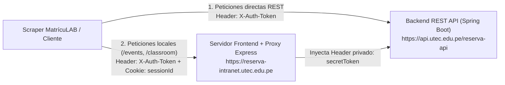

# 📡 Documentación de Endpoints y Scraping — Intranet de Reservas UTEC

Este documento detalla la arquitectura, autenticación, esquemas de datos y todos los endpoints descubiertos (mediante análisis de tráfico e ingeniería inversa del bundle `/assets/app.js`) del sistema de **Reserva de Aulas e Intranet de UTEC**, así como su integración con los scripts de scraping de **MatrícuLAB**.

---

## 🏗️ 1. Arquitectura de Servidores de UTEC

El sistema de consulta de aulas y horarios de la intranet opera sobre **dos servidores distintos** que trabajan en conjunto:



1. **Backend REST API (`https://api.utec.edu.pe/reserva-api`)**
   * **Tecnología:** Java / Spring Boot.
   * **Autenticación:** Requiere únicamente la cabecera `X-Auth-Token` (un JWT firmado con `HS512`).
   * **Función:** Expone los catálogos maestros de aulas reservables, tipos de ambientes, intervalos horarios, sedes, categorías y permisos de usuario.
2. **Servidor Web / Proxy Interno (`https://reserva-intranet.utec.edu.pe`)**
   * **Tecnología:** Node.js + Express + React (Isomorphic Flux/Redux).
   * **Autenticación:** Requiere la cookie de sesión `Cookie: sessionId=s%3A...` y la cabecera `X-Auth-Token`.
   * **Función Crítica:** Algunos endpoints del backend de Spring Boot (como `/calendarioaula/eventos/aula/`) exigen una cabecera interna llamada `secretToken` que el navegador no conoce. El servidor Express en `reserva-intranet.utec.edu.pe` expone las rutas proxy `/events/` y `/classroom`, valida la cookie `sessionId` e inyecta el `secretToken` antes de consultar al backend.

---

## 🔐 2. Credenciales y Cabeceras Requeridas

Para ejecutar un scraping completo se necesitan dos valores extraídos desde las DevTools del navegador (`F12` ➔ pestaña **Network** o **Application**) tras iniciar sesión en `https://reserva-intranet.utec.edu.pe`:

| Credencial | Ubicación en Navegador | Formato / Ejemplo | Uso |
| :--- | :--- | :--- | :--- |
| **`X-Auth-Token`** | Request Headers o `localStorage` | `eyJhbGciOiJIUzUxMiJ9...` (JWT con `sub: usuario@utec.edu.pe`, duración ~4 horas) | Obligatorio en `api.utec.edu.pe` y `reserva-intranet.utec.edu.pe` |
| **`sessionId`** | Cookies de `reserva-intranet.utec.edu.pe` | `s:4I8DUAPaPgs...` (enviado como `Cookie: sessionId=s%3A...` o sin URL-encode) | Obligatorio en `reserva-intranet.utec.edu.pe/events/` y `/classroom` |

---

## ✅ 3. Endpoints Scrapeables (Accesibles con Cuenta de Estudiante)

### 3.1. Catálogo General de Aulas Reservables
Obtiene la lista completa de las **111 aulas, laboratorios, salas de estudio y auditorios** habilitados en el campus de Barranco (`codsede=2`).

* **Método y URL:**
  ```http
  GET https://api.utec.edu.pe/reserva-api/filtro/aula/reservable?codsede=2
  ```
* **Headers:**
  * `Content-Type: application/json`
  * `X-Auth-Token: <JWT_TOKEN>`
* **Parámetros Query:**
  * `codsede`: `2` (Campus Barranco `UTEC-BA`). Nota: `codsede=1` devuelve un arreglo vacío `[]`.
* **Respuesta (`200 OK`):**
  ```json
  {
    "timestamp": 1793280203000,
    "uuid": null,
    "status": 200,
    "error": null,
    "message": "OK",
    "managed": true,
    "content": [
      { "codAula": 3137, "nomAliasAula": "A1001" },
      { "codAula": 1642, "nomAliasAula": "A906" },
      { "codAula": 3121, "nomAliasAula": "L420" }
    ]
  }
  ```

---

### 3.2. Catálogo de Tipos de Aula (`tipoaula`)
Lista las **10 categorías oficiales de espacios** registradas en la universidad.

* **Método y URL:**
  ```http
  GET https://api.utec.edu.pe/reserva-api/filtro/tipoaula
  ```
* **Headers:** `X-Auth-Token: <JWT_TOKEN>`
* **Respuesta (`200 OK`):**
  ```json
  {
    "status": 200,
    "message": "OK",
    "content": [
      { "codTipoAula": 4,   "descripcion": "Auditorio" },
      { "codTipoAula": 41,  "descripcion": "Aulas " },
      { "codTipoAula": 1,   "descripcion": "Aulas Mixtas" },
      { "codTipoAula": 161, "descripcion": "Aulas Posgrado" },
      { "codTipoAula": 81,  "descripcion": "Estudio de grabaciones" },
      { "codTipoAula": 5,   "descripcion": "Ficticio" },
      { "codTipoAula": 2,   "descripcion": "Laboratorio de Computo" },
      { "codTipoAula": 3,   "descripcion": "Laboratorio de especialidad" },
      { "codTipoAula": 61,  "descripcion": "Salas de estudio" },
      { "codTipoAula": 142, "descripcion": "[Futsal] Losa Deportiva Colaboradores" }
    ]
  }
  ```

---

### 3.3. Aulas Reservables Filtradas por Tipo de Ambiente
Permite obtener únicamente las aulas que pertenecen a un `codTipoAula` específico (útil para clasificar qué espacios son laboratorios vs. aulas mixtas vs. aulas de posgrado).

* **Método y URL:**
  ```http
  GET https://api.utec.edu.pe/reserva-api/filtro/aula/reservable/tipoaula?codsede=2&codtipoaula={codTipoAula}
  ```
* **Parámetros Query:**
  * `codsede`: `2`
  * `codtipoaula`: `0` (devuelve todas las 111 aulas) o el ID específico de la tabla anterior:

| `codTipoAula` | Categoría | Cantidad | Aulas Incluidas (`nomAliasAula(codAula)`) |
| :---: | :--- | :---: | :--- |
| **`4`** | Auditorio | 2 | `AUDITORIO(1623)`, `AULAMAGNA(2893)` |
| **`41`** | Aulas | 33 | `A201`–`A202`, `A401`–`A404`, `A501`–`A502`, `A601`–`A602`, `A701`–`A708`, `A801`–`A804`, `A901`–`A908`, `A1001`–`A1003` |
| **`1`** | Aulas Mixtas (Mesas) | 11 | `M301`, `M401`, `M601`–`M604`, `M801`–`M804`, `M1001` |
| **`161`** | Aulas Posgrado | 4 | `A301(2993)`, `A302(2994)`, `A303(2995)`, `A304(2996)` |
| **`81`** | Estudio de grabaciones | 1 | `S111(2833)` |
| **`5`** | Ficticio | 1 | `A701-A(2814)` |
| **`2`** | Laboratorio de Cómputo | 0 | *(Vacío — reclasificados bajo tipo 3)* |
| **`3`** | Laboratorio de especialidad | 48 | `L021`–`L022`, `L101`–`L108`, `L201`–`L212` (incl. `L203E`), `L402`–`L420`, `L501`–`L508`, `L601` |
| **`61`** | Salas de estudio | 10 | `E801(2448)` al `E810(2457)` |
| **`142`** | Losa Deportiva | 1 | `Futsal(2974)` |

---

### 3.4. Cronograma de Eventos y Clases por Aula (`/events/`) — ⭐ Endpoint Principal
Devuelve **todas las clases académicas, reservas de exámenes, mantenimientos y eventos extracurriculares** programados en un aula específica dentro de un rango de fechas. Soporta consultar desde un solo día hasta **todo el semestre completo** (ej. `01/08/2026` al `31/12/2026`) en una sola llamada por aula.

* **Método y URL:**
  ```http
  POST https://reserva-intranet.utec.edu.pe/events/
  ```
* **Headers:**
  * `Content-Type: application/json`
  * `X-Auth-Token: <JWT_TOKEN>`
  * `Cookie: sessionId=<SESSION_COOKIE>`
* **Body JSON:**
  ```json
  {
    "codAula": 1642,
    "fechaInicial": "01/08/2026",
    "fechaFinal": "31/12/2026"
  }
  ```
* **Respuesta (`200 OK`):**
  ```json
  {
    "timestamp": 1793280207000,
    "status": 200,
    "message": "OK",
    "content": [
      {
        "title": "BI5326-Biología Sintética 2 - Sec.1 - TEO - Grupo 1 - Docente\tAlberto Donayre",
        "start": "28/10/2026 20:00",
        "end": "28/10/2026 22:00"
      },
      {
        "title": ":Reserva para Examenes Parciales",
        "start": "01/10/2026 20:00",
        "end": "01/10/2026 22:00"
      },
      {
        "title": "RESERVADO",
        "start": "26/10/2026 16:30",
        "end": "26/10/2026 17:30"
      }
    ]
  }
  ```
* **Anatomía del campo `title`:**
  1. **Sesión Académica Regular:**
     Sigue el patrón `<CODIGO>-<Nombre Curso> - Sec.<Seccion> - <TEO|LAB|PRA> - Grupo <Grupo> - Docente\t<Nombre Docente>`.
     * *Nota:* El nombre del docente en la intranet suele venir como `<PrimerNombre> <PrimerApellido>` separado por un tabulador `\t`. En MatrícuLAB se cruza con `Consulta_Horario.xlsx` mediante [`scripts/enrichClassrooms.ts`](./enrichClassrooms.ts) para obtener el formato oficial `Apellidos, Nombres`, correo `@utec.edu.pe` y vacantes.
  2. **Reserva Administrativa / Club / Mantenimiento:**
     Empieza con dos puntos `:` (ej. `:Mantenimiento TI`, `:Reserva para Examenes Parciales`, `:MAPFRE-PEDIDOS POSGRADO`).
  3. **Reserva Privada Genérica:**
     Aparece literalmente como `"RESERVADO"`.

---

### 3.5. Buscador Directo de Bloques de Aulas Libres (`/classroom`)
Endpoint del proxy Express que consulta los bloques horarios libres en una fecha específica filtrando por tipo de aula, duración del bloque (`intervalo`) y capacidad mínima.

* **Método y URL:**
  ```http
  POST https://reserva-intranet.utec.edu.pe/classroom
  ```
* **Headers:**
  * `Content-Type: application/json`
  * `X-Auth-Token: <JWT_TOKEN>`
  * `Cookie: sessionId=<SESSION_COOKIE>`
* **Body JSON:**
  ```json
  {
    "codAula": 0,
    "codTipoAula": 41,
    "fecha": "29/10/2026",
    "horaInicio": "08:00",
    "horaFin": "10:00",
    "intervalo": 1,
    "capacidadMinima": 0
  }
  ```
* **Respuesta (`200 OK`):**
  ```json
  {
    "status": 200,
    "message": "OK",
    "content": [
      {
        "codTipoAula": 41,
        "codAula": 3137,
        "nomAliasAula": "A1001",
        "fecha": "29/10/2026",
        "dia": 4,
        "horaInicio": "08:00",
        "horaFin": "09:00"
      }
    ]
  }
  ```

---

### 3.6. Catálogo de Intervalos Horarios (`/intervalodetalle`)
Devuelve los **48 bloques horarios de 30 minutos** en los que se divide el día (`00:00` a `24:00`).

* **Método y URL:**
  ```http
  GET https://api.utec.edu.pe/reserva-api/intervalodetalle
  ```
* **Headers:** `X-Auth-Token: <JWT_TOKEN>`
* **Respuesta (`200 OK`):**
  ```json
  {
    "status": 200,
    "message": "OK",
    "content": [
      { "codIntervaloDetalle": 161, "orden": 1, "horaInicio": "00:00", "horaFin": "00:30" },
      { "codIntervaloDetalle": 162, "orden": 2, "horaInicio": "00:30", "horaFin": "01:00" }
    ]
  }
  ```

---

### 3.7. Categorías Maestras de Reserva (`/core/filtromaestrotabladetalle`)
Devuelve los **15 motivos/categorías institucionales** con los que se etiquetan las reservas no académicas.

* **Método y URL:**
  ```http
  GET https://api.utec.edu.pe/reserva-api/core/filtromaestrotabladetalle?idmaestrotabla=RESERVATION_CATEGORY
  ```
* **Headers:** `X-Auth-Token: <JWT_TOKEN>`
* **Respuesta (`200 OK`):**
  ```json
  {
    "status": 200,
    "message": "OK",
    "content": [
      {
        "descripcionCorta": "ASESORIAS",
        "descripcionLarga": "ASESORIAS",
        "estado": "A",
        "idMaestrotablaDetalle": "CAT_ADVISER",
        "codMaestroDetalle": 1659,
        "valor": null
      },
      {
        "descripcionCorta": "CAPACITACIONES",
        "descripcionLarga": "CAPACITACIONES",
        "estado": "A",
        "idMaestrotablaDetalle": "CAT_TRAINING",
        "codMaestroDetalle": 1663,
        "valor": null
      }
    ]
  }
  ```

---

### 3.8. Reglas y Parámetros por Tipo de Aula (`/tipoaulavalorparam/cargarvalores/`)
Devuelve las restricciones de negocio configuradas para cada tipo de ambiente (tiempo máximo por reserva, tiempo mínimo de anticipación, límite semanal, etc.).

* **Método y URL:**
  ```http
  GET https://api.utec.edu.pe/reserva-api/tipoaulavalorparam/cargarvalores/?codtipoaula=41
  ```
* **Headers:** `X-Auth-Token: <JWT_TOKEN>`
* **Respuesta (`200 OK`):**
  ```json
  {
    "status": 200,
    "message": "OK",
    "content": [
      {
        "codigo": 6491,
        "valor": "100000",
        "codEntidadParametro": 380,
        "codRegistroEntidad": 41,
        "codEntidad": 13,
        "codParametro": 90,
        "nombreParametro": "Tiempo máximo por reserva  "
      },
      {
        "codigo": 6492,
        "valor": "0",
        "codEntidadParametro": 381,
        "codRegistroEntidad": 41,
        "codEntidad": 13,
        "codParametro": 91,
        "nombreParametro": "Tiempo mínimo de anticipación de reserva"
      }
    ]
  }
  ```

---

### 3.9. Metadatos de Sede (`/local`) y Permisos de Rol (`/core/opcion`)
* **Consultar Sede (`200 OK`):**
  ```http
  GET https://api.utec.edu.pe/reserva-api/local?codsede=2
  ```
  Devuelve `[{ "building": "UTEC-BA", "codSede": 2 }]`.
* **Consultar Permisos del Token Actual (`200 OK`):**
  ```http
  GET https://api.utec.edu.pe/reserva-api/core/opcion
  ```
  Devuelve las opciones habilitadas para el perfil del usuario (para un estudiante devuelve `/calendarioaula/eventos/aula`, `/disponibilidad/aula` y `/alumno`).

---

## 🗺️ 4. Mapeo de `codAula` (ID en Requests) a Aulas Físicas en la Realidad

Cuando el navegador o el scraper consulta los horarios en `POST https://reserva-intranet.utec.edu.pe/events/`, el request envía únicamente un identificador numérico interno (`codAula`, por ejemplo `1642` o `3121`), y la respuesta JSON **no incluye el nombre del aula**, solo el arreglo de eventos `[{ title, start, end }]`.

Para reconstruir a qué aula física real pertenece cada `codAula`, el sistema realiza un **mapeo en tres etapas**:

```mermaid
flowchart TD
    A["1. Catálogo API (/filtro/aula/reservable?codsede=2)"] -->|Devuelve par clave-valor| B["codAula: 1642 ➔ nomAliasAula: 'A906'\ncodAula: 3121 ➔ nomAliasAula: 'L420'"]
    B -->|2. Parser físico (parseLocationInfo)| C["Letra = Tipo ('A' Aula, 'L' Lab, 'M' Mesas)\nDígitos = Piso + N° de Salón"]
    D["Excel Matrícula ('UTEC-BA A906')"] -->|Limpia prefijo 'UTEC-BA'| C
    C --> E["Objeto ClassroomInfo en MatrícuLAB\n{ code: 'L420', displayName: 'Laboratorio 420', type: 'laboratorio', floor: 4 }"]
```

### Etapa 1: Diccionario Maestro `codAula` ↔ `nomAliasAula`
Antes de pedir los eventos a `/events/`, el scraper consulta `GET /reserva-api/filtro/aula/reservable?codsede=2` (cuya copia de referencia se almacena en [`scratch/aulas_list.json`](../scratch/aulas_list.json)). Este endpoint entrega la tabla de verdad que asocia cada ID primario de la base de datos de UTEC (`codAula`) con su alias corto (`nomAliasAula`).

Adicionalmente, al iterar `GET /reserva-api/filtro/aula/reservable/tipoaula?codsede=2&codtipoaula={id}`, sabemos exactamente bajo qué categoría administrativa (`codTipoAula`) fue registrada cada aula en la base de datos de UTEC.

### Etapa 2: Decodificación del Código Físico (`parseLocationInfo`)
En [`src/utils/classroomUtils.ts`](../src/utils/classroomUtils.ts) (líneas 39–89), la función `parseLocationInfo(rawLoc)` convierte tanto el `nomAliasAula` de la intranet (ej. `"A1001"`, `"L420"`) como la columna `Ubicación` del Excel de matrícula (ej. `"UTEC-BA A906"`) a su ubicación real en el edificio de Barranco:

1. **Limpieza de sede:** Se elimina el prefijo `"UTEC-BA "` (presente en `Consulta_Horario.xlsx`) para obtener el código limpio (`"A906"`).
2. **Identificación del Tipo de Ambiente por Prefijo (`^[ALM](\d{3,4})$`):**
   * **`A`** ➔ **Aula Estándar** (`type: 'aula'`, ej. `A906` ➔ `"Aula 906"`).
   * **`L`** ➔ **Laboratorio** (`type: 'laboratorio'`, ej. `L420` ➔ `"Laboratorio 420"`).
   * **`M`** ➔ **Aula Mixta / Mesas** (`type: 'mesas'`, ej. `M804` ➔ `"Mesas 804"`).
   * **`AUDITORIO` / `AULAMAGNA`** ➔ **Auditorios** en el Piso 1 (`type: 'auditorio'`).
   * **`E`** ➔ **Salas de Estudio** (`E801`–`E810` en el Piso 8, excluidas del buscador de clases porque son cubículos grupales).
   * **`S111`** ➔ **Estudio de Grabaciones** (`codTipoAula: 81`).
3. **Cálculo del Piso Físico (`floor`):**
   * **Códigos de 3 dígitos (`X` + `YY`, ej. `L420`, `A906`, `L021`):** El **primer dígito** es el piso (`4` = Piso 4, `9` = Piso 9, `0` = Sótano) y los **dos últimos dígitos** son el número correlativo del salón en ese piso (`20`, `06`, `21`).
   * **Códigos de 4 dígitos (`XX` + `YY`, ej. `A1001`, `M1001`):** Los **dos primeros dígitos** indican el piso (`10` = Piso 10) y los **dos últimos** el salón (`01`).

### Etapa 3: Cronología de los `codAula` (Cómo detectar aulas nuevas vs. antiguas)
Los IDs `codAula` son secuencias numéricas (`AUTO_INCREMENT` / `SEQUENCE` en la base de datos de UTEC), lo que revela cuándo fue creado cada ambiente:
* **`725` y `1598` – `1849`:** Aulas y laboratorios originales del campus (pisos 1, 2, 4, 5, 6, 7, 8 y 9, como `A906 = 1642` o `L405 = 1599`).
* **`2287` – `2457`:** Laboratorios de sótano (`L021`, `L022`) y cubículos de estudio del piso 8 (`E801`–`E810`).
* **`2670` – `3097`:** Ampliación de aulas en pisos 2, 3, 4, 5, 6, 9 y 10 (`A201`–`A602`, `A908`, `A1003`, `L104`–`L108`, `L207`–`L212`).
* **`3117` – `3137`:** Últimos ambientes creados en el sistema: los laboratorios **`L416` (`3117`), `L417` (`3118`), `L418` (`3119`), `L419` (`3120`), `L420` (`3121`)** y el aula **`A1001` (`3137`)**.

### 📋 Tabla Completa de Mapeo (`codAula` ➔ Aula Real)

| `codAula` | `nomAliasAula` | Nombre Físico Real | Piso | Categoría Intranet (`codTipoAula`) | Estado en Scraper MatrícuLAB |
| :---: | :---: | :--- | :---: | :--- | :--- |
| `2287` | `L021` | Laboratorio 021 | Sótano (0) | `3` - Lab. de especialidad | ✅ Incluido (`laboratorio`) |
| `2288` | `L022` | Laboratorio 022 | Sótano (0) | `3` - Lab. de especialidad | ✅ Incluido (`laboratorio`) |
| `1623` | `AUDITORIO` | Auditorio Principal | Piso 1 | `4` - Auditorio | ✅ Incluido (`auditorio`) |
| `2893` | `AULAMAGNA` | Aula Magna | Piso 1 | `4` - Auditorio | ✅ Incluido (`auditorio`) |
| `1747` | `L101` | Laboratorio 101 | Piso 1 | `3` - Lab. de especialidad | ✅ Incluido (`laboratorio`) |
| `1600` | `L102` | Laboratorio 102 | Piso 1 | `3` - Lab. de especialidad | ✅ Incluido (`laboratorio`) |
| `3037` | `L104` | Laboratorio 104 | Piso 1 | `3` - Lab. de especialidad | ✅ Incluido (`laboratorio`) |
| `2997` | `L105` | Laboratorio 105 | Piso 1 | `3` - Lab. de especialidad | ✅ Incluido (`laboratorio`) |
| `3038` | `L106` | Laboratorio 106 | Piso 1 | `3` - Lab. de especialidad | ✅ Incluido (`laboratorio`) |
| `3039` | `L107` | Laboratorio 107 | Piso 1 | `3` - Lab. de especialidad | ✅ Incluido (`laboratorio`) |
| `3040` | `L108` | Laboratorio 108 | Piso 1 | `3` - Lab. de especialidad | ✅ Incluido (`laboratorio`) |
| `2833` | `S111` | Estudio de grabaciones S111 | Piso 1 | `81` - Estudio de grabaciones | ✅ Incluido (`otro`) |
| `2974` | `Futsal` | Losa Deportiva Futsal | Piso 1 | `142` - Losa Deportiva | ✅ Incluido (`otro`) |
| `2670` | `A201` | Aula 201 | Piso 2 | `41` - Aulas | ✅ Incluido (`aula`) |
| `2672` | `A202` | Aula 202 | Piso 2 | `41` - Aulas | ✅ Incluido (`aula`) |
| `1640` | `L201` | Laboratorio 201 | Piso 2 | `3` - Lab. de especialidad | ✅ Incluido (`laboratorio`) |
| `1646` | `L202` | Laboratorio 202 | Piso 2 | `3` - Lab. de especialidad | ✅ Incluido (`laboratorio`) |
| `2710` | `L203E` | Sub-laboratorio 203E | Piso 2 | `3` - Lab. de especialidad | 🚫 Excluido (`L203E`) |
| `1648` | `L204` | Laboratorio 204 | Piso 2 | `3` - Lab. de especialidad | ✅ Incluido (`laboratorio`) |
| `1649` | `L205` | Laboratorio 205 | Piso 2 | `3` - Lab. de especialidad | ✅ Incluido (`laboratorio`) |
| `1654` | `L206` | Laboratorio 206 | Piso 2 | `3` - Lab. de especialidad | ✅ Incluido (`laboratorio`) |
| `2998` | `L207` | Laboratorio 207 | Piso 2 | `3` - Lab. de especialidad | ✅ Incluido (`laboratorio`) |
| `2933` | `L208` | Laboratorio 208 | Piso 2 | `3` - Lab. de especialidad | ✅ Incluido (`laboratorio`) |
| `3017` | `L209` | Laboratorio 209 | Piso 2 | `3` - Lab. de especialidad | ✅ Incluido (`laboratorio`) |
| `2915` | `L210` | Laboratorio 210 | Piso 2 | `3` - Lab. de especialidad | ✅ Incluido (`laboratorio`) |
| `3057` | `L211` | Laboratorio 211 | Piso 2 | `3` - Lab. de especialidad | ✅ Incluido (`laboratorio`) |
| `3058` | `L212` | Laboratorio 212 | Piso 2 | `3` - Lab. de especialidad | ✅ Incluido (`laboratorio`) |
| `2993` | `A301` | Aula 301 | Piso 3 | `161` - Aulas Posgrado | ✅ Incluido (`aula`) |
| `2994` | `A302` | Aula 302 | Piso 3 | `161` - Aulas Posgrado | ✅ Incluido (`aula`) |
| `2995` | `A303` | Aula 303 | Piso 3 | `161` - Aulas Posgrado | ✅ Incluido (`aula`) |
| `2996` | `A304` | Aula 304 | Piso 3 | `161` - Aulas Posgrado | ✅ Incluido (`aula`) |
| `1602` | `M301` | Mesas 301 | Piso 3 | `1` - Aulas Mixtas | ✅ Incluido (`mesas`) |
| `2673` | `A401` | Aula 401 | Piso 4 | `41` - Aulas | ✅ Incluido (`aula`) |
| `2674` | `A402` | Aula 402 | Piso 4 | `41` - Aulas | ✅ Incluido (`aula`) |
| `3077` | `A403` | Aula 403 | Piso 4 | `41` - Aulas | ✅ Incluido (`aula`) |
| `3078` | `A404` | Aula 404 | Piso 4 | `41` - Aulas | ✅ Incluido (`aula`) |
| `3079` | `M401` | Mesas 401 | Piso 4 | `1` - Aulas Mixtas | ✅ Incluido (`mesas`) |
| `1787` | `L402` | Laboratorio 402 | Piso 4 | `3` - Lab. de especialidad | ✅ Incluido (`laboratorio`) |
| `1606` | `L403` | Laboratorio 403 | Piso 4 | `3` - Lab. de especialidad | ✅ Incluido (`laboratorio`) |
| `1598` | `L404` | Laboratorio 404 | Piso 4 | `3` - Lab. de especialidad | ✅ Incluido (`laboratorio`) |
| `1599` | `L405` | Laboratorio 405 | Piso 4 | `3` - Lab. de especialidad | ✅ Incluido (`laboratorio`) |
| `1603` | `L406` | Laboratorio 406 | Piso 4 | `3` - Lab. de especialidad | ✅ Incluido (`laboratorio`) |
| `1604` | `L407` | Laboratorio 407 | Piso 4 | `3` - Lab. de especialidad | ✅ Incluido (`laboratorio`) |
| `1617` | `L408` | Laboratorio 408 | Piso 4 | `3` - Lab. de especialidad | ✅ Incluido (`laboratorio`) |
| `1616` | `L409` | Laboratorio 409 | Piso 4 | `3` - Lab. de especialidad | ✅ Incluido (`laboratorio`) |
| `1849` | `L410` | Laboratorio 410 | Piso 4 | `3` - Lab. de especialidad | ✅ Incluido (`laboratorio`) |
| `1656` | `L412` | Laboratorio 412 | Piso 4 | `3` - Lab. de especialidad | ✅ Incluido (`laboratorio`) |
| `1655` | `L413` | Laboratorio 413 | Piso 4 | `3` - Lab. de especialidad | ✅ Incluido (`laboratorio`) |
| `1652` | `L414` | Laboratorio 414 | Piso 4 | `3` - Lab. de especialidad | ✅ Incluido (`laboratorio`) |
| `2690` | `L415` | Laboratorio 415 | Piso 4 | `3` - Lab. de especialidad | ✅ Incluido (`laboratorio`) |
| `3117` | `L416` | Laboratorio 416 | Piso 4 | `3` - Lab. de especialidad | ✅ Incluido (`laboratorio`) |
| `3118` | `L417` | Laboratorio 417 | Piso 4 | `3` - Lab. de especialidad | ✅ Incluido (`laboratorio`) |
| `3119` | `L418` | Laboratorio 418 | Piso 4 | `3` - Lab. de especialidad | ✅ Incluido (`laboratorio`) |
| `3120` | `L419` | Laboratorio 419 | Piso 4 | `3` - Lab. de especialidad | ✅ Incluido (`laboratorio`) |
| `3121` | `L420` | Laboratorio 420 | Piso 4 | `3` - Lab. de especialidad | ✅ Incluido (`laboratorio`) |
| `1650` | `A501` | Aula 501 | Piso 5 | `41` - Aulas | ✅ Incluido (`aula`) |
| `2730` | `A502` | Aula 502 | Piso 5 | `41` - Aulas | ✅ Incluido (`aula`) |
| `1767` | `L501` | Laboratorio 501 | Piso 5 | `3` - Lab. de especialidad | ✅ Incluido (`laboratorio`) |
| `1614` | `L502` | Laboratorio 502 | Piso 5 | `3` - Lab. de especialidad | ✅ Incluido (`laboratorio`) |
| `1615` | `L503` | Laboratorio 503 | Piso 5 | `3` - Lab. de especialidad | ✅ Incluido (`laboratorio`) |
| `1732` | `L504` | Laboratorio 504 | Piso 5 | `3` - Lab. de especialidad | ✅ Incluido (`laboratorio`) |
| `725` | `L505` | Laboratorio 505 | Piso 5 | `3` - Lab. de especialidad | ✅ Incluido (`laboratorio`) |
| `1618` | `L506` | Laboratorio 506 | Piso 5 | `3` - Lab. de especialidad | ✅ Incluido (`laboratorio`) |
| `1601` | `L507` | Laboratorio 507 | Piso 5 | `3` - Lab. de especialidad | ✅ Incluido (`laboratorio`) |
| `1605` | `L508` | Laboratorio 508 | Piso 5 | `3` - Lab. de especialidad | ✅ Incluido (`laboratorio`) |
| `2675` | `A601` | Aula 601 | Piso 6 | `41` - Aulas | ✅ Incluido (`aula`) |
| `2676` | `A602` | Aula 602 | Piso 6 | `41` - Aulas | ✅ Incluido (`aula`) |
| `2773` | `L601` | Laboratorio 601 | Piso 6 | `3` - Lab. de especialidad | ✅ Incluido (`laboratorio`) |
| `1613` | `M601` | Mesas 601 | Piso 6 | `1` - Aulas Mixtas | ✅ Incluido (`mesas`) |
| `1612` | `M602` | Mesas 602 | Piso 6 | `1` - Aulas Mixtas | ✅ Incluido (`mesas`) |
| `1611` | `M603` | Mesas 603 | Piso 6 | `1` - Aulas Mixtas | ✅ Incluido (`mesas`) |
| `1608` | `M604` | Mesas 604 | Piso 6 | `1` - Aulas Mixtas | ✅ Incluido (`mesas`) |
| `1619` | `A701` | Aula 701 | Piso 7 | `41` - Aulas | ✅ Incluido (`aula`) |
| `2814` | `A701-A` | Sub-aula ficticia 701-A | Piso 7 | `5` - Ficticio | 🚫 Excluido (`-A`) |
| `1625` | `A702` | Aula 702 | Piso 7 | `41` - Aulas | ✅ Incluido (`aula`) |
| `1628` | `A703` | Aula 703 | Piso 7 | `41` - Aulas | ✅ Incluido (`aula`) |
| `1621` | `A704` | Aula 704 | Piso 7 | `41` - Aulas | ✅ Incluido (`aula`) |
| `1624` | `A705` | Aula 705 | Piso 7 | `41` - Aulas | ✅ Incluido (`aula`) |
| `1634` | `A706` | Aula 706 | Piso 7 | `41` - Aulas | ✅ Incluido (`aula`) |
| `1636` | `A707` | Aula 707 | Piso 7 | `41` - Aulas | ✅ Incluido (`aula`) |
| `1630` | `A708` | Aula 708 | Piso 7 | `41` - Aulas | ✅ Incluido (`aula`) |
| `1627` | `A801` | Aula 801 | Piso 8 | `41` - Aulas | ✅ Incluido (`aula`) |
| `1626` | `A802` | Aula 802 | Piso 8 | `41` - Aulas | ✅ Incluido (`aula`) |
| `1622` | `A803` | Aula 803 | Piso 8 | `41` - Aulas | ✅ Incluido (`aula`) |
| `1620` | `A804` | Aula 804 | Piso 8 | `41` - Aulas | ✅ Incluido (`aula`) |
| `1635` | `M801` | Mesas 801 | Piso 8 | `1` - Aulas Mixtas | ✅ Incluido (`mesas`) |
| `1633` | `M802` | Mesas 802 | Piso 8 | `1` - Aulas Mixtas | ✅ Incluido (`mesas`) |
| `1631` | `M803` | Mesas 803 | Piso 8 | `1` - Aulas Mixtas | ✅ Incluido (`mesas`) |
| `1629` | `M804` | Mesas 804 | Piso 8 | `1` - Aulas Mixtas | ✅ Incluido (`mesas`) |
| `2448`–`2457` | `E801`–`E810` | Salas de Estudio 801–810 | Piso 8 | `61` - Salas de estudio | 🚫 Excluidos (`E*`) |
| `1639` | `A901` | Aula 901 | Piso 9 | `41` - Aulas | ✅ Incluido (`aula`) |
| `1638` | `A902` | Aula 902 | Piso 9 | `41` - Aulas | ✅ Incluido (`aula`) |
| `1637` | `A903` | Aula 903 | Piso 9 | `41` - Aulas | ✅ Incluido (`aula`) |
| `1644` | `A904` | Aula 904 | Piso 9 | `41` - Aulas | ✅ Incluido (`aula`) |
| `1643` | `A905` | Aula 905 | Piso 9 | `41` - Aulas | ✅ Incluido (`aula`) |
| `1642` | `A906` | Aula 906 | Piso 9 | `41` - Aulas | ✅ Incluido (`aula`) |
| `1641` | `A907` | Aula 907 | Piso 9 | `41` - Aulas | ✅ Incluido (`aula`) |
| `2677` | `A908` | Aula 908 | Piso 9 | `41` - Aulas | ✅ Incluido (`aula`) |
| `3137` | `A1001` | Aula 1001 | Piso 10 | `41` - Aulas | ✅ Incluido (`aula`) |
| `1970` | `A1002` | Aula 1002 | Piso 10 | `41` - Aulas | ✅ Incluido (`aula`) |
| `3097` | `A1003` | Aula 1003 | Piso 10 | `41` - Aulas | ✅ Incluido (`aula`) |
| `3080` | `M1001` | Mesas 1001 | Piso 10 | `1` - Aulas Mixtas | ✅ Incluido (`mesas`) |

---

## 🔒 5. Endpoints Administrativos o Internos (Restringidos `403` / `400`)

Al analizar el código fuente del cliente de UTEC (`/assets/app.js`, objeto `REST_OPERATIONS`), existen rutas adicionales que **no pueden ser invocadas directamente con credenciales de estudiante**:

| Método y Ruta en `api.utec.edu.pe/reserva-api` | Código HTTP | Motivo y Modelo Interno en `app.js` |
| :--- | :---: | :--- |
| `GET /aula?codsede=2` | `403 Forbidden` | Exclusivo para administradores (`/mantenimiento/aulas`). Devuelve el modelo completo con `capacidadAula`, `metrosCuadrados`, `reservable` (`true`/`false`) y `listaAulaDetalle` (equipamiento del salón). |
| `GET /calendarioaula/eventos/aula/?codaula={id}&fechainicial={ini}&fechafinal={fin}` | `400 Bad Request` | Devuelve `Missing request header 'secretToken'`. **Solución:** Consumirlo siempre a través del proxy `POST https://reserva-intranet.utec.edu.pe/events/`. |
| `GET /tipoaula?codsede=2` | `403 Forbidden` | CRUD administrativo de tipos de aula (`/mantenimiento/tipoaulas`). Usar `/filtro/tipoaula` en su lugar. |
| `GET /planificacion` | `403 Forbidden` | CRUD de plantillas de horarios de atención por día (`codPlanificacion`, `listaPlanificacionDetalle`). |
| `GET /parametros` | `403 Forbidden` | Fechas límite globales (`maxFechaReserva`, `maxFechaCanchaReserva`). |
| `POST /reserva/consultar/admin` y `/reserva/consultar/me` | `403 Forbidden` | Reporte detallado de reservas con usuario solicitante. Requiere permisos en `/core/opcion`. |
| `POST /reserva/registrar/me` y `DELETE /reserva/eliminar/me` | `403` / Restringido | Creación y cancelación de reservas de salas de estudio o canchas cuando el perfil tiene habilitada la opción correspondiente. |

---

## 🛠️ 6. Uso en los Scripts de MatrícuLAB (`scripts/`)

En este repositorio contamos con cuatro scripts automatizados que consumen estos endpoints y construyen los archivos JSON estáticos de la aplicación:

1. **[`scripts/scrapeAulasIntranet.ts`](./scrapeAulasIntranet.ts)** — Descarga las reservas de una semana específica (por defecto lunes a sábado de la semana actual) y las cruza automáticamente con `Consulta_Horario.xlsx`:
   ```bash
   npx tsx scripts/scrapeAulasIntranet.ts \
     --token="TU_X_AUTH_TOKEN" \
     --cookie="s:TU_SESSION_ID" \
     --start="26/10/2026" \
     --end="31/10/2026"
   ```
2. **[`scripts/scrapeSemesterAvailability.ts`](./scrapeSemesterAvailability.ts)** — Descarga los eventos de **las 16 semanas completas del semestre** (`01/08/2026` al `31/12/2026`) para todas las aulas válidas, filtra reservas esporádicas de un solo día y consolida los bloques semanales recurrentes en `public/data/classrooms_intranet.json` y `public/data/classrooms_semester_consolidated.json`:
   ```bash
   UTEC_AUTH_TOKEN="TU_X_AUTH_TOKEN" \
   UTEC_SESSION_ID="sessionId=s%3ATU_SESSION_ID" \
   npx tsx scripts/scrapeSemesterAvailability.ts
   ```
3. **[`scripts/enrichClassrooms.ts`](./enrichClassrooms.ts)** — Cruza `public/data/classrooms_intranet.json` con `public/samples/Consulta_Horario.xlsx` para normalizar los nombres de los docentes al formato `Apellidos, Nombres`, agregar sus correos `@utec.edu.pe` y completar el número de vacantes.
4. **[`scripts/buildCoursesCatalog.ts`](./buildCoursesCatalog.ts)** — Toma el Excel de matrícula y el JSON de aulas scrapeadas para generar los catálogos pre-compilados (`courses_catalog.json`, `professors_catalog.json` y `enriched_courses.json`).

---

## ⚠️ 7. Notas sobre Discrepancias entre Intranet y Vida Real

Al analizar los datos de la intranet frente al uso físico del campus, ten en cuenta estos casos:

* **Traslados físicos no registrados en Intranet (ej. `BI5326 - Biología Sintética 2`):**
  En ocasiones un curso es cargado por Servicios Académicos como sesión de `TEORÍA` en un aula estándar (ej. `BI5326` los miércoles de 20:00 a 22:00 en `A906`) porque el laboratorio destino (`L420`, `codAula: 3121`) fue dado de alta recientemente en la base de datos y aún no figuraba en el sistema de matrícula al momento de armar el Excel. Aunque el docente traslade la clase físicamente a `L420` (que figura libre en el sistema a esa hora), el endpoint `/events/` seguirá reportando la reserva formal en `A906` hasta que Servicios Académicos actualice la reserva en el sistema.
* **Exclusiones intencionales en el Scraper:**
  Los scripts filtran automáticamente los cubículos/salas de estudio (`E801`–`E810`), sub-aulas ficticias (`A701-A`) y el espacio `L203E` para que el buscador de aulas libres muestre únicamente salones de clase, aulas mixtas (`M`), laboratorios (`L`) y auditorios.

